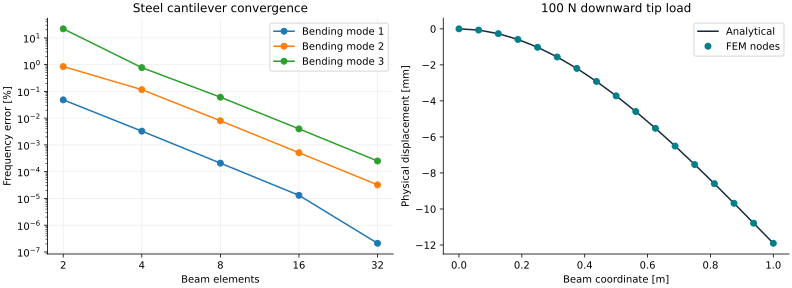

# VIBRA — Structural Dynamics & FEM Workbench

VIBRA is an open-source Python engineering workbench for small structural models,
modal analysis and vibration studies. This first release combines real numerical
solvers, independent analytical verification, and an interactive engineering UI.
It is intended for education and inspectable engineering exploration, with explicit
assumptions and limits.

## Current capabilities

- Validated SI engineering models: materials, sections, geometry, nodes, elements,
  degrees of freedom, supports, nodal loads and analysis configurations.
- Two-node **2D Euler–Bernoulli frame elements**, with axial displacement,
  transverse displacement and rotation per node, arbitrary planar orientation,
  consistent mass matrices and deterministic dense global assembly.
- Linear static analysis: displacement, rotation, support reactions and local
  element axial/shear/end-moment forces; beam shape and moment diagrams.
- Undamped modal analysis: generalized eigenvalues, rad/s and Hz, mass-normalized
  modes, axial/bending classification and cantilever mesh convergence.
- Separate mass-spring-damper SDOF model: free/harmonic forcing, initial displacement
  and velocity, under/critical/overdamping, time responses and mechanical energy.
- Streamlit + Plotly workbench for static cantilevers, cantilever modes and SDOF;
  parameter forms, mode selection, explicit display magnification and JSON reports.
- Automated numerical verification and reproducible examples, including generated
  reports and standalone interactive HTML figures.



## Install and launch

Requires Python 3.12+ and [uv](https://docs.astral.sh/uv/). The lockfile and CI use
Python 3.12. No MATLAB, ANSYS, Docker, database or credentials are needed.

```bash
git clone https://github.com/AsherFerdinand/VIBRA.git
cd VIBRA
uv sync --frozen
uv run streamlit run frontend/app.py --server.address 0.0.0.0 --server.port 8501
```

In Codex Cloud, use the existing `/workspace/VIBRA` checkout. If the default uv
cache is read-only, set `export UV_CACHE_DIR=/workspace/.cache/uv` before uv commands.
Run the app on your own accessible host/browser; the onboarding UI does not provide
a localhost preview. The server needs no external services.

Choose an analysis, enter dimensions and SI material properties, configure the
mesh/supports and load, then **Run analysis**. Inspect the plots, nodal results or
frequency table, and **Export engineering report (JSON)**. The current beam UI
uses a fixed root and free tip; the Python model supports individual zero DOF
constraints and general connected planar frames. Modal loads are ignored because
prestress is outside this linear model. Results retain their submitted inputs
until the next solve.

## Equations and verification

Static equilibrium: **Ku = F**. Undamped modes: **Kφ = ω²Mφ**, **f = ω/(2π)**.
SDOF: **mẍ + cẋ + kx = F₀ sin(2πft)**.

A cantilever under transverse tip load F has δ = FL³/(3EI) and θ = FL²/(2EI).
Its bending frequencies satisfy ωₙ = βₙ²√(EI/(ρAL⁴)), with
cosh(βₙ)cos(βₙ) = −1. VIBRA compares against these independent equations,
checks reaction equilibrium, and separates axial modes from bending modes.

The illustrative steel example uses L = 1 m, a 20 × 20 mm square section,
E = 210 GPa, ρ = 7850 kg/m³ and a −100 N tip force. The 16-element solver gives:

| Quantity | FEM result | Analytical reference |
| --- | ---: | ---: |
| Tip transverse displacement | −11.9047619 mm | −11.9047619 mm |
| Tip rotation | −0.01785714286 rad | −0.01785714286 rad |
| Root transverse reaction | +100 N | +100 N |
| Root reaction moment | +100 N m | +100 N m |
| First bending frequency | 16.7103341 Hz | 16.7103319 Hz |
| Second bending frequency | 104.722397 Hz | 104.721862 Hz |
| Third bending frequency | 293.235904 Hz | 293.224247 Hz |

At 32 elements, all first three bending frequency errors are below **0.0003%**.
The verification suite also checks matrix symmetry/definiteness, rigid-body modes,
energy, orientation invariance, invalid models, SDOF analytical responses and all
three interface workflows. Full tolerances and results are in
[verification](docs/verification.md) and the
[machine-readable report](docs/results/verification.json).
These are numerical verification and analytical benchmarks, **not experimental
validation**. No proprietary CAE comparisons have been performed.

## Reproduce results and quality checks

```bash
uv run pytest --junitxml=artifacts/pytest.xml
uv run ruff check .
uv run ruff format --check .
uv run mypy
uv run vibra-verify
uv run python examples/steel_cantilever.py
uv run python examples/sdof_resonance.py
uv run python scripts/generate_portfolio.py
uv build
```

Examples create `artifacts/steel-cantilever/` and `artifacts/sdof/` with full JSON
results and self-contained interactive HTML plots. `vibra-verify` writes
`artifacts/verification.json` and fails if benchmark targets fail. The portfolio
script regenerates the actual SVG/PNG figures and reference report in `docs/results/`.
CI runs lint, formatting, strict type checks, tests, benchmarks, examples and package
builds. Dependency versions and artifact hashes are recorded in `uv.lock`.

## Architecture and limitations

Numerical modules use NumPy, SciPy and Pydantic; Plotly/Streamlit provide the initial
interface. Matplotlib is development-only for static portfolio figures. See the
[architecture](docs/architecture.md), [element and solver formulation](docs/formulation.md),
[verification](docs/verification.md) and [roadmap](docs/roadmap.md).

This release supports connected small planar models, linear materials, rigid
joints, nodal forces/moments and zero displacement constraints. Dense matrices
are suitable for educational meshes. It does not include shear deformation,
cross-sectional rotary inertia, distributed loads, internal hinges, nonzero
prescribed displacement, geometric nonlinearity, stress recovery, 3D FEM, contact,
FEM harmonic/transient response or FFT diagnostics. Slenderness, displacement
size and high-mode validity remain engineering judgments; a passed algebraic
residual is not proof of physical model suitability. The UI warns for L/h < 10
and static displacement exceeding 5% of length.

Next: verified **beam harmonic response** and damping, followed by FEM transient
dynamics and signal diagnostics. FastAPI and React remain future options; the
numerical core is already independent of the workbench interface.

VIBRA is independently developed and is not affiliated with ANSYS.
Licensed under the [MIT License](LICENSE).
