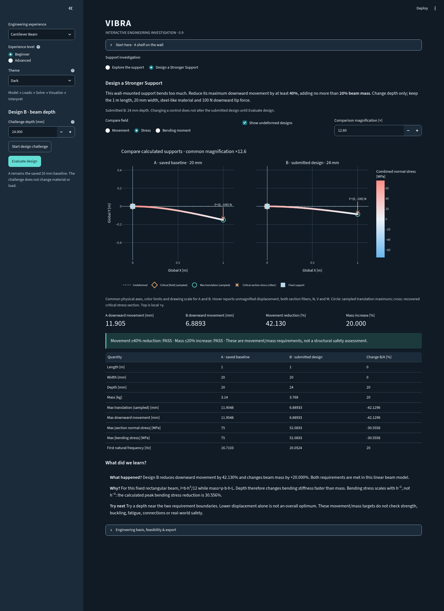

# VIBRA — see the structure, understand the vibration

Why does a shelf support bend? When can a motor isolator reduce shaking force?
What can a vibration recording actually tell you?

VIBRA is an educational engineering workbench for exploring those questions with
real, independently verified numerical methods. **Version 0.9.0 starts in Beginner
mode:** a short scenario, a one-click example, a physical visualization, and a
computed explanation. The complete engineering workbench remains in Advanced mode.

## Start here

Requires Python 3.12+ and [uv](https://docs.astral.sh/uv/). No credentials, ANSYS,
MATLAB, database, Docker, or dedicated GPU are required.

```bash
git clone --branch feat/interactive-engineering-investigation --single-branch https://github.com/AsherFerdinand/VIBRA.git
cd VIBRA
uv sync --frozen
uv run streamlit run frontend/app.py --server.address 0.0.0.0 --server.port 8501
```

In Codex Cloud, use the existing `/workspace/VIBRA` checkout. If the default uv cache
is read-only, set `export UV_CACHE_DIR=/workspace/.cache/uv` first. Use your own
accessible host/browser; the onboarding UI does not provide a loopback preview.

Choose an experience, read or collapse **Start here**, and press its example button:

| Experience | Physical story | One-click example | What to notice |
| --- | --- | --- | --- |
| Cantilever Beam | A wall-mounted shelf support carrying a load | **Run shelf example** | The tip moves most; a critical stress section is at the fixed end |
| Automotive Motor Mount | An electric motor on a supporting rail | **Run motor example** | Isolators trade movement against frequency-dependent force transmission |
| Vibration Diagnostics | A sensor recording a washing-machine spin segment | **Analyze Example** | Time history, repeating rates and overall RMS level; no fault diagnosis |

Read the [Getting Started walkthrough](docs/getting-started.md) for all three examples.

## Beginner or Advanced

**Beginner** shows only essential controls and meaningful defaults. Guided changes
let you thicken the beam, increase its load, soften motor mounts, or move two
synthetic vibration frequencies closer together. Every submitted result ends with
**What happened? → Why? → Try next**, using actual computed quantities.

**Advanced** retains static, modal, harmonic, transient, SDOF, signal/CSV processing,
convergence, verification and export controls. The 0.5 bare-rail reference and the
0.6 installed bare/rigid/isolated motor studies remain available. Advanced signal
processing can use the latest submitted Beginner spin recording as well as FEM or
user CSV data. No numerical solver or signal-processing algorithm changed in 0.9.

## Investigate a design, not just a graph

Choose **Cantilever Beam → Design a Stronger Support → Start design challenge**.
Change depth from 20 to 24 mm and **Evaluate design**. The actual FEM calculation
reduces downward movement by 42.13% while adding 20% beam mass, meeting both
simplified targets. Compare saved A and submitted B on shared axes, magnification
and color limits. Inspect displacement, stress and N/V/M together by hover.
A requirement pass is not a strength or real-world safety approval.

The solved model is central; results and computed interpretation follow below.
Motor exploration offers bare/rigid/isolated topologies and full-complex harmonic
snapshots; diagnostics pairs the original time samples with their spectrum.
Secondary plots and numerical tools are collapsible. Parameter edits require an
explicit solve; visual controls preserve submitted numerical results.

Read the [Engineering Investigation guide](docs/engineering-investigation.md) for
challenge feasibility, A/B steps, sign conventions, motor tradeoffs and limitations.

## Light and Dark

The sidebar **Theme** selector changes the interface, model sketches, engineering
viewports, Plotly charts, annotations, legends and animation controls. Themes are
session-local and do not rerun or modify submitted numerical results. Signed stress
still means blue for compression, red for tension, with the same zero-centered
numeric limits; the dark ramp is brightened for contrast.

These are genuine Chromium screenshots of the implemented application:

| Example | Light | Dark |
| --- | --- | --- |
| A/B support challenge | [Open screenshot](docs/screenshots/0.9/challenge-light.png) | [Open screenshot](docs/screenshots/0.9/challenge-dark.png) |
| Motor | [Open screenshot](docs/screenshots/0.9/motor-light.png) | [Open screenshot](docs/screenshots/0.9/motor-dark.png) |
| Simulated spin recording | [Open screenshot](docs/screenshots/0.9/diagnostics-light.png) | [Open screenshot](docs/screenshots/0.9/diagnostics-dark.png) |



[Browser evidence](docs/screenshots/0.9/browser-checks.json) records rendered colors,
contrast checks and page errors for all six views. Native browser dialogs and some
Streamlit data grids can retain their own appearance. The app uses stable widget
roles/test identifiers rather than changing global server theme configuration.

Measured cloud CPU costs for the new two-design viewport are about 86 ms and
132 KB of Plotly JSON; a candidate static/modal/recovery calculation took about
6.5 ms. These exclude browser/Streamlit memory and are not laptop guarantees.
See the [executed performance report](docs/results/investigation-performance.json).

## What the examples compute

| Default example | Computed result | Interpretation boundary |
| --- | --- | --- |
| Shelf support, 100 N downward | Tip Y −11.9048 mm; peak section normal stress magnitude 75 MPa | A slender beam equivalent, not a complete shelf/fastener or strength approval |
| 12 kg motor, isolators, 60 Hz force | Root-force amplitude 3.332% of input, versus 9.062% for rigid attachment | Frequency-specific, assumed properties; not an energy-efficiency percentage or validated vehicle result |
| Simulated 12/24 Hz spin recording | Dominant bin 12 Hz; original-record RMS approximately 0.43692 m/s² | Synthetic stationary acceleration, not a measured appliance or a fault model |

Physical displacement differs from drawing magnification. Beam section stress
is not a 3D solid/contact field. Modal display amplitude is arbitrary. A spectral
peak alone does not diagnose a mechanical fault.

## Reproduce and verify

```bash
uv run python examples/beginner_workflows.py
uv run python examples/support_design_investigation.py
uv run pytest --junitxml=artifacts/pytest.xml
uv run ruff check .
uv run ruff format --check .
uv run mypy
uv run vibra-verify
uv run vibra-verify-harmonic
uv run vibra-verify-transient
uv run vibra-verify-signals
uv run vibra-verify-installed
uv run vibra-verify-stress
uv build
```

The beginner example writes actual shelf, installed-motor, synthetic-signal and deterministic
interpretation JSON under `artifacts/beginner-workflows/`. All earlier examples and
GitHub Actions checks remain. The lockfile selects Python 3.12 dependencies. No new
runtime dependencies or cloud services were introduced.

## Technical documentation

The numerical core remains independent of Streamlit and Plotly. It includes:

- Consistent-mass, oriented 2D Euler–Bernoulli frames and exact zero-constraint elimination.
- Static equilibrium, undamped mass-normalized modes, direct complex harmonic response,
  and implicit Newmark average-acceleration transient dynamics.
- Concentrated mass/offset planar inertia, ground/relative spring-dampers, full explicit
  mount damping, energy/work/dissipation accounting and reaction recovery.
- Verified local beam force/stress recovery and Hermite displacement reconstruction.
- Independent FFT/PSD, calibrated amplitude/power normalization, RMS/metrics,
  validated SI CSV input, and full-sample FEM signal integration.

Read [architecture](docs/architecture.md), [beam formulation](docs/formulation.md),
[harmonic theory](docs/harmonic-response.md), [transient theory](docs/transient-response.md),
[signal theory](docs/signal-diagnostics.md), [bare-rail study](docs/automotive-nvh-study.md),
[installed motor dynamics](docs/installed-motor-dynamics.md),
[stress and viewport theory](docs/interactive-workbench.md),
[verification](docs/verification.md), and the [roadmap](docs/roadmap.md).

VIBRA uses linear, planar, small-displacement assumptions. It does not predict
production automotive accuracy, solid/contact stresses, fatigue life, acoustic noise,
or validated vehicle NVH. Numerical verification is not experimental validation or
ANSYS correlation. VIBRA is independently developed and is not affiliated with ANSYS.
