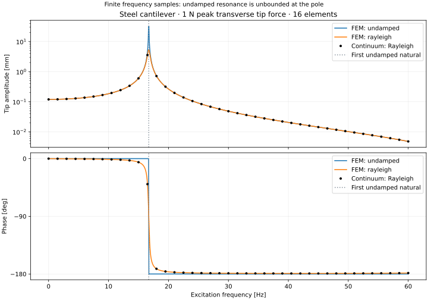
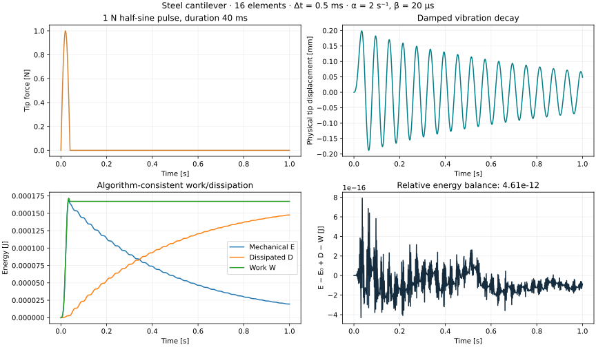
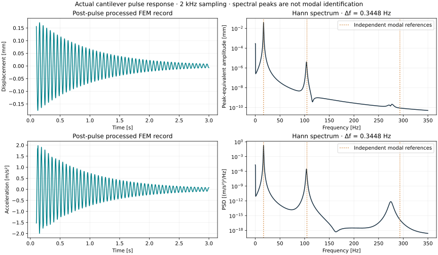
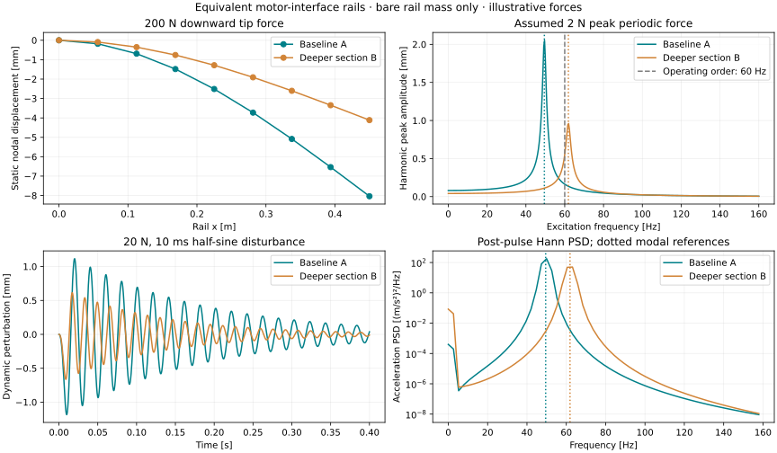

# VIBRA — Structural Dynamics & FEM Workbench

VIBRA is an open-source Python engineering workbench for small structural models,
modal analysis and vibration studies. The current release combines real numerical
solvers, independent analytical verification, and an interactive engineering UI.
It is intended for education and inspectable engineering exploration, with explicit
assumptions and limits.

## Current capabilities

- Validated SI engineering models: materials, sections, geometry, nodes, elements,
  degrees of freedom, supports, nodal loads and analysis configurations.
- Two-node **2D Euler–Bernoulli frame elements**, with axial displacement,
  transverse displacement and rotation per node, arbitrary planar orientation,
  consistent mass matrices and deterministic dense global assembly.
- Linear static analysis: displacement, rotation, support reactions and local
  element axial/shear/end-moment forces; beam shape and moment diagrams.
- Undamped modal analysis: generalized eigenvalues, rad/s and Hz, mass-normalized
  modes, axial/bending classification and cantilever mesh convergence.
- **Verified FEM harmonic response**: direct complex frequency sweeps, harmonic
  nodal forces/moments with phases, undamped/mass/stiffness/Rayleigh damping,
  multiple response DOFs, amplitude/phase, sampled peaks and conditioning checks.
- **Verified transient FEM dynamics**: implicit Newmark average acceleration,
  step/harmonic/pulse/sampled forcing, initial states, multiple response DOFs,
  dynamic reactions and complete mechanical-energy/work/dissipation accounting.
- **Verified signal diagnostics**: one-sided FFT peak/RMS amplitudes, power/PSD,
  periodic windows with coherent-gain/ENBW scaling, time metrics, band RMS,
  validated SI CSV import and full-sample transient FEM integration.
- **Automotive NVH engineering study**: a reproducible bare support-rail comparison
  orchestrating static/modal/harmonic/transient/spectral solvers, controlled parameter
  and station studies, convergence checks, JSON/Markdown reports and actual figures.
- **Installed motor dynamics (0.6)**: concentrated mass/COM rotational inertia with
  offset coupling; ground or relative directional spring-dampers; exact rigid offset
  kinematics; bare/rigid/isolated motor comparisons and force-transmission studies.
- Separate mass-spring-damper SDOF model: free/harmonic forcing, initial displacement
  and velocity, under/critical/overdamping, time responses and mechanical energy.
- Streamlit + Plotly workbench for static cantilevers, cantilever modes, harmonic
  FEM, transient FEM, Signal Diagnostics and SDOF;
  parameter forms, mode selection, explicit display magnification and JSON reports.
- Automated numerical verification and reproducible examples, including generated
  reports and standalone interactive HTML figures.


## Install and launch

Requires Python 3.12+ and [uv](https://docs.astral.sh/uv/). The lockfile and CI use
Python 3.12. No MATLAB, ANSYS, Docker, database or credentials are needed.

```bash
git clone --branch feat/installed-motor-dynamics --single-branch https://github.com/AsherFerdinand/VIBRA.git
cd VIBRA
uv sync --frozen
uv run streamlit run frontend/app.py --server.address 0.0.0.0 --server.port 8501
```

In Codex Cloud, use the existing `/workspace/VIBRA` checkout. If the default uv
cache is read-only, set `export UV_CACHE_DIR=/workspace/.cache/uv` before uv commands.
Run the app on your own accessible host/browser; the onboarding UI does not provide
a localhost preview. The server needs no external services.

Choose an analysis, enter dimensions and SI material properties, configure the
mesh/supports and load, then **Run analysis**. Inspect the plots, nodal results or
frequency table, and export an engineering JSON report. The current beam UI
uses a fixed root and free tip; the Python model supports individual zero DOF
constraints and general connected planar frames. Modal loads are ignored because
prestress is outside this linear model. Results retain their submitted inputs
until the next solve.

## Equations and verification

Static equilibrium: **Ku = F**. Undamped modes: **Kφ = ω²Mφ**, **f = ω/(2π)**.
Harmonic FEM: **(K + jωC − ω²M)U = F**, with **C = αM + βK + C_mount**.
SDOF: **mẍ + cẋ + kx = F₀ sin(2πft)**.

A cantilever under transverse tip load F has δ = FL³/(3EI) and θ = FL²/(2EI).
Its bending frequencies satisfy ωₙ = βₙ²√(EI/(ρAL⁴)), with
cosh(βₙ)cos(βₙ) = −1. VIBRA compares against these independent equations,
checks reaction equilibrium, and separates axial modes from bending modes.

The illustrative steel example uses L = 1 m, a 20 × 20 mm square section,
E = 210 GPa, ρ = 7850 kg/m³ and a −100 N tip force. The 16-element solver gives:

| Quantity | FEM result | Analytical reference |
| --- | ---: | ---: |
| Tip transverse displacement | −11.9047619 mm | −11.9047619 mm |
| Tip rotation | −0.01785714286 rad | −0.01785714286 rad |
| Root transverse reaction | +100 N | +100 N |
| Root reaction moment | +100 N m | +100 N m |
| First bending frequency | 16.7103341 Hz | 16.7103319 Hz |
| Second bending frequency | 104.722397 Hz | 104.721862 Hz |
| Third bending frequency | 293.235904 Hz | 293.224247 Hz |

At 32 elements, all first three bending frequency errors are below **0.0003%**.
The verification suite also checks matrix symmetry/definiteness, rigid-body modes,
energy, orientation invariance, invalid models, SDOF analytical responses and all
seven interface workflows. Full tolerances and results are in
[verification](docs/verification.md) and the
[machine-readable report](docs/results/verification.json).
These are numerical verification and analytical benchmarks, **not experimental
validation**. No proprietary CAE comparisons have been performed.

## Harmonic response workspace

Select **Harmonic response** to configure excitation location/DOF, peak amplitude,
load phase, frequency range/resolution, damping and multiple response locations.
Inspect amplitude and phase, sampled resonance peaks, undamped natural-frequency
markers, and the actual complex-response beam deformation at a selected frequency
and cycle phase. Export complete inputs, complex results and numerical diagnostics.

The phasor convention is u(t) = Re(U exp(jωt)); forces are peak cosine-reference
phasors. Beam harmonic response is separate from the existing lumped SDOF workflow.
The solver rejects unsafe dynamic stiffness at a reported frequency; it applies no
artificial regularization. Exact undamped poles have no unique finite response.



For the same steel beam with 1 N peak tip excitation, α = 2 s⁻¹, β = 2×10⁻⁵ s,
the 32-element complex tip-compliance error is below 2×10⁻⁷ across five specified
samples around the first mode. The independent SDOF complex-response/phase errors
are below 10⁻¹⁰. These are verification results for documented benchmarks, not a
claim that arbitrary user models are physically validated. See
[harmonic theory, tolerances and results](docs/harmonic-response.md) and the
[machine-readable harmonic report](docs/results/harmonic-verification.json).

## Transient response workspace

Version **0.3.0** adds **Transient response** with geometry/material/mesh inputs,
proportional viscous damping, nodal time-dependent forces, a validated uniform
step/duration, initial state and response selection. Inspect displacement, velocity,
acceleration, mechanical energy, dissipated energy, external work and support reactions.
Use the time slider or optional animation to inspect actual solved beam deformations
with explicit magnification, then export a bounded engineering report.

The solver uses **Newmark β_N=1/4, γ_N=1/2**. Finite force jumps keep displacement
and velocity continuous and reset acceleration consistently. Singular/poorly
conditioned systems and failed equilibrium/energy checks are rejected. Stability
and discrete energy conservation do not imply temporal phase accuracy; check both
time-step and mesh convergence. Sampled forcing uses documented linear interpolation.



The steel cantilever pulse example reaches about **0.199 mm** peak tip displacement;
post-pulse energy decays to **11.9%** at 1 s, with relative discrete energy residual
about **4.6×10⁻¹²**. Independent SDOF and continuous-beam benchmarks demonstrate
second-order time convergence and FEM spatial convergence. See the
[transient formulation, conventions and tolerances](docs/transient-response.md)
and [machine-readable report](docs/results/transient-verification.json).

## Signal Diagnostics workspace

Version **0.4.0** adds **Signal Diagnostics**. Select a full-sample transient FEM
channel (displacement, velocity or acceleration), or import a validated SI CSV.
Choose detrending and a rectangular/Hann/Hamming window; inspect time metrics,
peak-equivalent amplitude, PSD, band RMS, sampling metadata and modal references.
Export complete inputs, FFT configuration, results and provenance in bounded JSON.

FFT normalization handles DC and even/odd Nyquist behavior explicitly. PSD integration
recovers window-weighted mean square; rectangular PSD recovers unwindowed RMS².
Window coherent gain does not remove off-bin leakage/scalloping. Peaks are sampled
spectral estimates, and a nearby FEM natural frequency does not establish modal identity.



The cantilever example computes a real 3 s pulse response, then analyzes post-pulse
tip displacement and acceleration at 2 kHz. Their dominant bin is **16.54887 Hz**,
compared with a separately computed first FEM natural frequency of **16.71033 Hz**;
Δf is **0.3447681 Hz**. Coherent-tone amplitude and PSD benchmark errors are below
10⁻¹¹, while off-bin estimates and noise have explicit approximate/statistical
criteria. See [signal theory](docs/signal-diagnostics.md), the
[verification report](docs/results/signal-verification.json) and
[demo metadata](docs/results/signal-demo.json).

## Automotive NVH Study

Version **0.5.0** adds **Automotive NVH Study**, a complete baseline/modified
investigation using an equivalent EV motor-interface support rail. This is a bare,
force-driven slender-beam model, not a validated production bracket or installed
motor assembly. Motor inertia, joint/chassis compliance, strength/fatigue and
acoustics are outside the model boundary.



Increasing section depth from 12 to 15 mm adds **25% mass**, reduces static tip
deflection from **8.036 to 4.114 mm**, and raises the first natural frequency from
**49.512 to 61.890 Hz**. At the illustrative 2 N, 60 Hz operating order, response
instead increases from **0.1633 to 0.5534 mm** as resonance moves nearer that
frequency. The modified rail is not universally superior.

The workspace compares geometry, modal families/shapes, harmonic amplitude/phase,
pulse displacement/velocity/acceleration, energy/reactions and FFT/PSD. It also
runs controlled L/b/h/E/rho changes, damping/station/E-only harmonic studies, and
mesh/time convergence for both designs. Reports distinguish sampled peaks and
computed fine references from exact or experimental truth.

Run `uv run vibra-nvh-study` or `uv run python examples/automotive_nvh_study.py`
for full JSON/Markdown/HTML outputs under `artifacts/automotive-nvh-study/`.
See the [engineering case study](docs/automotive-nvh-study.md),
[generated report](docs/results/nvh-study.md) and [JSON summary](docs/results/nvh-summary.json).

## Reproduce results and quality checks

```bash
uv run pytest --junitxml=artifacts/pytest.xml
uv run ruff check .
uv run ruff format --check .
uv run mypy
uv run vibra-verify
uv run vibra-verify-harmonic
uv run vibra-verify-transient
uv run vibra-verify-signals
uv run python examples/steel_cantilever.py
uv run python examples/sdof_resonance.py
uv run python examples/harmonic_cantilever.py
uv run python examples/transient_cantilever.py
uv run python examples/cantilever_signal_diagnostics.py
uv run python examples/automotive_nvh_study.py
uv run python scripts/generate_portfolio.py
uv run python scripts/generate_harmonic_portfolio.py
uv run python scripts/generate_transient_portfolio.py
uv run python scripts/generate_signal_portfolio.py
uv run python scripts/generate_nvh_portfolio.py
uv build
```

Examples create `artifacts/steel-cantilever/`, `artifacts/sdof/` and
`artifacts/harmonic-cantilever/` and `artifacts/transient-cantilever/` with engineering JSON
results and self-contained interactive HTML plots. `vibra-verify` writes
`artifacts/verification.json` and fails if benchmark targets fail. The portfolio
script regenerates the actual SVG/PNG figures and reference report in `docs/results/`.
CI runs lint, formatting, strict type checks, tests, benchmarks, examples and package
builds. Signal import requires uniform sampling, explicit SI units and no missing
data; it never silently resamples. CSV is limited to 10 MiB/131072 samples and
signal JSON exports to 25 MB. Dependency versions and artifact hashes are recorded in `uv.lock`.

## Architecture and limitations

Numerical modules use NumPy, SciPy and Pydantic; Plotly/Streamlit provide the initial
interface. Matplotlib is development-only for static portfolio figures. See the
[architecture](docs/architecture.md), [element and solver formulation](docs/formulation.md),
[verification](docs/verification.md) and [roadmap](docs/roadmap.md).

This release supports connected small planar models, linear materials, rigid
joints, nodal forces/moments and zero displacement constraints. Dense matrices
are suitable for educational meshes. It does not include shear deformation,
cross-sectional rotary inertia, distributed loads, internal hinges, nonzero
prescribed displacement, geometric nonlinearity, stress recovery, 3D FEM or contact. Harmonic FEM supports proportional
viscous damping, constant load phasors and zero supports; frequency-dependent load
spectra and base excitation are not included. Explicit mount damping can be
nonproportional and is included directly. Transient FEM uses uniform steps,
Rayleigh plus explicit mount damping, aligned force jumps and fixed supports;
it does not implement nonlinear dynamics, moving supports or Dirac impulses.
Slenderness, displacement size and high-mode validity remain engineering judgments; a passed algebraic
residual is not proof of physical model suitability. The UI warns for L/h < 10
and displacement exceeding 5% of length (harmonic checks use a complex translation norm).

Next: verified **base motion and chassis force paths**, controlled mode tracking,
then measured mount/force/FRF comparisons. Motor inertia and compliant mounts (0.6)
join the implemented harmonic (0.2), transient (0.3), signal (0.4) and bare-rail (0.5)
capabilities.
FastAPI and React remain future options; the numerical core is already independent of the workbench interface.

VIBRA is independently developed and is not affiliated with ANSYS.
Licensed under the [MIT License](LICENSE).

## Installed motor and compliant mounts (0.6.0)

Select **Automotive NVH Study → Installed motor A/B/C**. The original bare-rail
A/B investigation remains available. A 12 kg idealized motor lowers the first
frequency from 49.512 Hz to 6.696 Hz with rigid attachment and 5.492 Hz with relative
isolators. At the assumed 60 Hz force, root-force ratios are 3.932, 0.0906 and 0.0333;
isolators add 2.5 mm static movement. These are frequency-specific tradeoffs, not
an optimum or measured motor-mount behavior.


```bash
uv run vibra-verify-installed
uv run vibra-installed-study
uv run python examples/installed_motor_study.py
uv run python scripts/generate_installed_portfolio.py
```

Read [installed model theory and results](docs/installed-motor-dynamics.md), the
[generated report](docs/results/installed-study.md) and
[independent benchmark tolerances](docs/results/installed-verification.json).
Full bounded JSON/Markdown/HTML outputs are in `artifacts/installed-motor-study/`.
Mount damping is assembled independently of Rayleigh damping; modal analysis is
undamped. Energy accounting includes added inertia, spring energy and dashpot loss.
These planar linear models do not establish production accuracy, fatigue life,
acoustic performance, vehicle NVH, experimental validation or ANSYS correlation.
