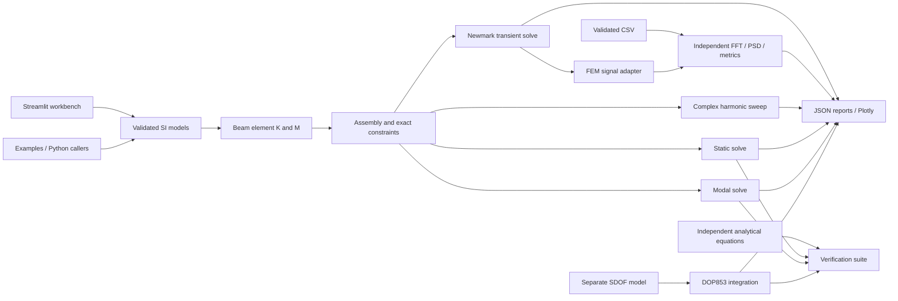

# Architecture and contribution guide

The Python package has no Streamlit dependency in its numerical modules. The UI
is a caller of the same solvers used by tests and examples. Public engineering
input models are frozen Pydantic models; validated topology is independent of
assembly. Results are typed dataclasses containing NumPy arrays in deterministic
node order. Result arrays are caller-owned and should be treated as read-only.



| Location | Responsibility |
| --- | --- |
| `src/vibra/core/models.py` | material, section, nodes, elements, DOFs, supports, loads, analysis options |
| `src/vibra/core/mesh.py` | validated straight geometry, deterministic cantilever mesh |
| `src/vibra/core/element.py` | local stiffness/mass and orientation transformation |
| `src/vibra/core/assembly.py` | global dense matrices, DOF map, constraint elimination and stability |
| `src/vibra/solvers/` | static, modal, harmonic and transient FEM solvers with diagnostic checks |
| `src/vibra/dynamics/` | separate lumped SDOF equation and time integration |
| `src/vibra/verification/` | independent analytical solutions and convergence reports |
| `src/vibra/visualization/` | Plotly engineering figures, Hermite shape interpolation |
| `src/vibra/io/` | versioned SI JSON reports, explicit verification scope |
| `src/vibra/workbench/` | harmonic/transient Streamlit workspaces; no numerical module imports it |
| `frontend/app.py` | parameter forms, submitted-result state, inspection and export |
| `examples/` | executable beam and SDOF cases producing actual plots |
| `tests/` | unit, analytical, integration and invalid-input checks |

No placeholder API service or unimplemented numerical modules are created. Future
features should enter the package only when they can be exercised and verified.

## Reproducibility and configuration

Python 3.12 is the reference environment (`.python-version`). `uv.lock` locks direct
and transitive production/development dependencies. Use `uv sync --frozen`; run
checks through `uv run` or the environment's executables. No credentials or external
services are required for the application. Package download access is needed for a
fresh installation. Matplotlib is a development-only dependency for portfolio SVGs;
Plotly serves interactive runtime figures.

`AnalysisConfig` contains requested mode count and dimensionless stability tolerance.
`FrameModel.model_dump(mode="json")` can serialize a complete input model, and
`FrameModel.model_validate(...)` can reconstruct it. Reports carry input definitions,
SI conventions, schema/package versions and numerical results. A report records the
last submitted UI model even if form inputs have subsequently been edited.

Solvers emit informative Python logger messages without configuring the host
application's handlers. The Streamlit entry point configures INFO logging. Examples
are deterministic; no random excitation or hidden external input is used.

## Development checks

```bash
uv sync --frozen
uv run ruff check .
uv run ruff format --check .
uv run mypy
uv run pytest --junitxml=artifacts/pytest.xml
uv run vibra-verify
uv run vibra-verify-harmonic
uv run vibra-verify-transient
uv run vibra-verify-signals
uv run python examples/steel_cantilever.py
uv run python examples/sdof_resonance.py
uv run python examples/harmonic_cantilever.py
uv run python examples/transient_cantilever.py
uv run python examples/cantilever_signal_diagnostics.py
uv run python scripts/generate_portfolio.py
uv build
```

CI executes these checks (except portfolio regeneration, whose generated artifacts
are versioned). There are no paid engineering tools, Docker or MATLAB prerequisites.
Keep tests based on independent mechanics equations or invariants; do not replace
benchmarks with snapshots of the same implementation.

## Harmonic extension

`solvers/harmonic.py` owns validated damping, forcing, response and frequency inputs
and returns full complex global response plus selected amplitudes/phases. It reuses
`assemble` and `constrained_system`; static/modal and lumped SDOF solvers remain
independent. `visualization/harmonic.py` plots actual results, while
`workbench/harmonic.py` owns only Streamlit controls and submitted-result state.

`io/harmonic_report.py` adds complete phasor reports using the generic JSON
encoder's real/imag complex-array representation.
`verification/harmonic_analytical.py` contains independent continuous beam and SDOF
formulas. `verification/harmonic_benchmarks.py` writes CI-readable check outcomes.
See [harmonic response](harmonic-response.md) for conditioning, phase masks and
sampled-peak limitations. The dependency set is unchanged for this extension.

## Transient extension (0.3)

`core/dynamic_models.py` now owns shared damping and response-coordinate definitions.
Harmonic imports re-export these unchanged names, preserving the 0.2 Python API.
`dynamics/forcing.py` defines validated step, harmonic, rectangular/half-sine pulse
and sampled histories, with explicit right/left limits.

`solvers/transient.py` owns time-grid/initial-state inputs, average-acceleration
Newmark integration, consistent initial acceleration, jump treatment, numerical
guards and energy/reaction recovery. It reuses the same assembly and constraints.
`visualization/transient.py` plots real histories, energy, deformation and bounded
actual-frame animation; `workbench/transient.py` contains Streamlit controls only.
`io/transient_report.py` bounds export sampling without modifying integration.

`verification/transient_analytical.py` supplies continuous SDOF and continuous-beam
references; `verification/transient_benchmarks.py` writes independent time/mesh/energy
checks. The dependency set is unchanged. See [transient theory](transient-response.md)
for energy quadrature, force events, initial conditions and output-size conventions.

## Independent signal diagnostics (0.4)

`signals/models.py` defines validated SI records, sampling and FFT options.
`signals/analysis.py` uses NumPy/SciPy to compute periodic-window FFT amplitude,
RMS/power, modified periodogram PSD, metrics and sampled peaks. It neither calls
FEM solvers nor requires FEM data. `signals/fem.py` alone adapts full transient
histories and separately computes modal references.

`io/signal_csv.py` performs bounded column-selected CSV import without resampling;
`io/signal_report.py` exports complete bounded provenance and spectral results.
`visualization/signals.py` and `workbench/signals.py` provide the sixth workspace.
`verification/signal_benchmarks.py` owns independent analytical/statistical checks;
`verification/signal_demo.py` defines an actual executable cantilever pulse case.
No FEM solver equations or dependency declarations were changed for this release.
See [signal theory](signal-diagnostics.md) for PSD/ENBW and endpoint conventions.
