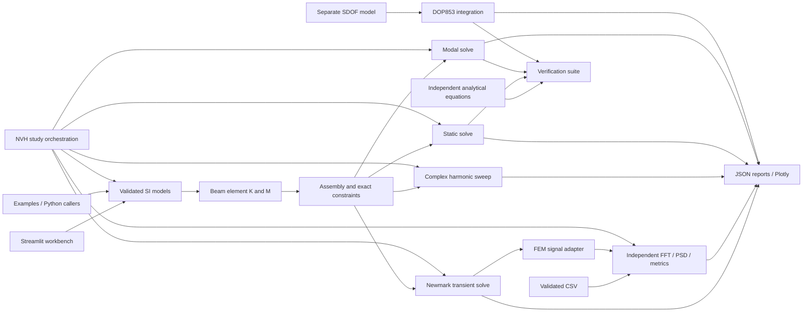

# Architecture and contribution guide

The Python package has no Streamlit dependency in its numerical modules. The UI
is a caller of the same solvers used by tests and examples. Public engineering
input models are frozen Pydantic models; validated topology is independent of
assembly. Results are typed dataclasses containing NumPy arrays in deterministic
node order. Result arrays are caller-owned and should be treated as read-only.



| Location | Responsibility |
| --- | --- |
| `src/vibra/core/models.py` | material, section, nodes, elements, DOFs, supports, loads, analysis options |
| `src/vibra/core/mesh.py` | validated straight geometry, deterministic cantilever mesh |
| `src/vibra/core/element.py` | local stiffness/mass and orientation transformation |
| `src/vibra/core/assembly.py` | global dense matrices, DOF map, constraint elimination and stability |
| `src/vibra/solvers/` | static, modal, harmonic and transient FEM solvers with diagnostic checks |
| `src/vibra/dynamics/` | separate lumped SDOF equation and time integration |
| `src/vibra/verification/` | independent analytical solutions and convergence reports |
| `src/vibra/visualization/` | Plotly engineering figures, Hermite shape interpolation |
| `src/vibra/io/` | versioned SI JSON reports, explicit verification scope |
| `src/vibra/workbench/` | harmonic/transient Streamlit workspaces; no numerical module imports it |
| `frontend/app.py` | parameter forms, submitted-result state, inspection and export |
| `examples/` | executable beam and SDOF cases producing actual plots |
| `tests/` | unit, analytical, integration and invalid-input checks |

No placeholder API service or unimplemented numerical modules are created. Future
features should enter the package only when they can be exercised and verified.

## Reproducibility and configuration

Python 3.12 is the reference environment (`.python-version`). `uv.lock` locks direct
and transitive production/development dependencies. Use `uv sync --frozen`; run
checks through `uv run` or the environment's executables. No credentials or external
services are required for the application. Package download access is needed for a
fresh installation. Matplotlib is a development-only dependency for portfolio SVGs;
Plotly serves interactive runtime figures.

`AnalysisConfig` contains requested mode count and dimensionless stability tolerance.
`FrameModel.model_dump(mode="json")` can serialize a complete input model, and
`FrameModel.model_validate(...)` can reconstruct it. Reports carry input definitions,
SI conventions, schema/package versions and numerical results. A report records the
last submitted UI model even if form inputs have subsequently been edited.

Solvers emit informative Python logger messages without configuring the host
application's handlers. The Streamlit entry point configures INFO logging. Examples
are deterministic; no random excitation or hidden external input is used.

## Development checks

```bash
uv sync --frozen
uv run ruff check .
uv run ruff format --check .
uv run mypy
uv run pytest --junitxml=artifacts/pytest.xml
uv run vibra-verify
uv run vibra-verify-harmonic
uv run vibra-verify-transient
uv run vibra-verify-signals
uv run python examples/steel_cantilever.py
uv run python examples/sdof_resonance.py
uv run python examples/harmonic_cantilever.py
uv run python examples/transient_cantilever.py
uv run python examples/cantilever_signal_diagnostics.py
uv run python examples/automotive_nvh_study.py
uv run python scripts/generate_portfolio.py
uv build
```

CI executes these checks (except portfolio regeneration, whose generated artifacts
are versioned). There are no paid engineering tools, Docker or MATLAB prerequisites.
Keep tests based on independent mechanics equations or invariants; do not replace
benchmarks with snapshots of the same implementation.

## Harmonic extension

`solvers/harmonic.py` owns validated damping, forcing, response and frequency inputs
and returns full complex global response plus selected amplitudes/phases. It reuses
`assemble` and `constrained_system`; static/modal and lumped SDOF solvers remain
independent. `visualization/harmonic.py` plots actual results, while
`workbench/harmonic.py` owns only Streamlit controls and submitted-result state.

`io/harmonic_report.py` adds complete phasor reports using the generic JSON
encoder's real/imag complex-array representation.
`verification/harmonic_analytical.py` contains independent continuous beam and SDOF
formulas. `verification/harmonic_benchmarks.py` writes CI-readable check outcomes.
See [harmonic response](harmonic-response.md) for conditioning, phase masks and
sampled-peak limitations. The dependency set is unchanged for this extension.

## Transient extension (0.3)

`core/dynamic_models.py` now owns shared damping and response-coordinate definitions.
Harmonic imports re-export these unchanged names, preserving the 0.2 Python API.
`dynamics/forcing.py` defines validated step, harmonic, rectangular/half-sine pulse
and sampled histories, with explicit right/left limits.

`solvers/transient.py` owns time-grid/initial-state inputs, average-acceleration
Newmark integration, consistent initial acceleration, jump treatment, numerical
guards and energy/reaction recovery. It reuses the same assembly and constraints.
`visualization/transient.py` plots real histories, energy, deformation and bounded
actual-frame animation; `workbench/transient.py` contains Streamlit controls only.
`io/transient_report.py` bounds export sampling without modifying integration.

`verification/transient_analytical.py` supplies continuous SDOF and continuous-beam
references; `verification/transient_benchmarks.py` writes independent time/mesh/energy
checks. The dependency set is unchanged. See [transient theory](transient-response.md)
for energy quadrature, force events, initial conditions and output-size conventions.

## Independent signal diagnostics (0.4)

`signals/models.py` defines validated SI records, sampling and FFT options.
`signals/analysis.py` uses NumPy/SciPy to compute periodic-window FFT amplitude,
RMS/power, modified periodogram PSD, metrics and sampled peaks. It neither calls
FEM solvers nor requires FEM data. `signals/fem.py` alone adapts full transient
histories and separately computes modal references.

`io/signal_csv.py` performs bounded column-selected CSV import without resampling;
`io/signal_report.py` exports complete bounded provenance and spectral results.
`visualization/signals.py` and `workbench/signals.py` provide the sixth workspace.
`verification/signal_benchmarks.py` owns independent analytical/statistical checks;
`verification/signal_demo.py` defines an actual executable cantilever pulse case.
No FEM solver equations or dependency declarations were changed for this release.
See [signal theory](signal-diagnostics.md) for PSD/ENBW and endpoint conventions.

## Engineering study orchestration (0.5)

`studies/nvh.py` validates two equivalent support-rail designs and common load
cases, constructs supported models, and calls the existing solvers. Typed results
retain actual static/modal/harmonic/transient/signal outputs. Controlled studies
and convergence reuse the same model builder, preserving physical station locations.
Convergence fields are reduced immediately to common-grid histories and diagnostics
to keep memory practical. No original numerical solver is modified.

`io/nvh_report.py` combines existing bounded transient/signal report helpers with
study data into JSON and Markdown. `visualization/nvh.py` renders results only;
`workbench/nvh.py` provides the seventh workspace. `studies/cli.py` and
`examples/automotive_nvh_study.py` regenerate reports and figures and fail if study
checks fail. `scripts/generate_nvh_portfolio.py` creates compact tracked figures,
a generated Markdown report and summary JSON; full JSON stays in artifacts/.

The [case-study documentation](automotive-nvh-study.md) defines the force-controlled
bare-rail boundary and separates it from motor/vehicle dynamics, strength or acoustic
claims. No additional dependencies or cloud services are used.

## Installed mass and mounts (0.6)

`core/models.py` adds immutable `NodalMass` and `LinearMount` inputs. Connectivity
includes relative mounts, allowing a rigid-body reference node without beam elements
or artificial stiffness. `core/assembly.py` alone owns inertia offsets and mount
kinematic maps, adding symmetric K/M and exposing explicit `mount_damping` separately.
`core/attachments.py` recovers explicitly specified spring/dashpot forces.

Static and modal algorithms use the augmented matrices unchanged. Modal families
account for mount strain energy. Harmonic and transient solvers add C_mount to the
existing alpha*M+beta*K and keep the direct complex/Newmark formulations, numerical
guards and exact elimination. Modal damping measures include full C but do not
remove off-diagonal coupling. Static and dynamic reports expose mount forces with
explicit signs and damping definitions. Existing fields and console commands remain.

`studies/installed.py` builds bare/rigid/relative-isolator topologies and orchestrates
solvers, force recovery, sensitivities and common-time displacement refinement.
`io/installed_report.py`, `visualization/installed.py`, `workbench/installed.py` and
`studies/installed_cli.py` preserve numerical/UI/report separation. The original
0.5 bare study is the default investigation in the same workspace.
`verification/installed_benchmarks.py` supplies independent equations and an executable
report; `scripts/generate_installed_portfolio.py` produces real numerical figures.
No dependencies or cloud services were added.

## Three-experience viewport and postprocessing (0.7)

`frontend/app.py` now routes Cantilever Beam, Automotive Motor Mount and Vibration
Diagnostics. `workbench/beam.py` retains the original static/modal/SDOF controls and
exports; existing harmonic, transient, signal and motor workflows remain reusable
modules. Their solver/session-state paths are preserved. Only UI navigation tests
were adapted to the grouping; their earlier solver/result assertions remain.

`postprocessing/beam.py` owns shared Hermite reconstruction, local elastic force
resultants and explicit-fiber section stress recovery. This module has no Streamlit
or Plotly dependency. `visualization/plots.py` reuses its interpolation, preserving
legacy trace ordering. No numerical solver was changed for this release. The only
numerical input addition is optional section extreme-fiber geometry.

`visualization/viewport.py` maps actual model/result data to geometry, supports,
loads, sensors, rigid offset points, inertia glyphs, contours and bounded frames.
Color/hover quantities are unscaled; magnification changes coordinates. Animation
geometry/color ranges are fixed across frames; actual force annotations and the
physical time cursor update together. `workbench/viewport.py` owns common controls
and computed interpretation. Beam stress never colors motor or mount glyphs.
`verification/stress_benchmarks.py` and unit/UI tests verify signs, transformations,
interpolation, units, critical locations and result/animation correspondence.
Screenshots are Chromium captures of the actual Streamlit app, not generated images.
No runtime dependencies or major physics solver were introduced.

## Storytelling, beginner controls and themes (0.8)

`frontend/app.py` defaults to Beginner and offers an explicit session-local theme
selector. `workbench/scenarios.py` owns compact collapsible reference stories and
model-based/sensor-schematic illustrations. `studies/beginner.py` only orchestrates
existing static/installed/signal APIs and defines reproducible teaching inputs and
synthetic provenance; it introduces no physics or signal-processing algorithm.
`workbench/beginner.py` owns essential controls and guided actions. Advanced workspaces
retain their prior controls and exports. The latest submitted synthetic record can
be handed to Advanced signal analysis without changing its samples.

`workbench/interpretation.py` formats deterministic What/Why/Try explanations from
submitted results, including source/fingerprint visibility for diagnostics. It does
not call an LLM, diagnose faults, fit material behavior or invent trends.

`visualization/theme.py` copies and styles figures without editing source arrays,
geometry, phases, frame states or numerical color limits. Signed stress retains
blue-negative/red-positive meaning with a brighter dark ramp. Every workbench Plotly
view goes through `workbench/presentation.py`; animations inherit themed frame/control
fonts and annotations. Session CSS covers native widgets using semantic selectors
for both BaseWeb and React Aria versions, without mutating global server configuration.
Native data-grid/file-dialog appearance remains a framework/browser boundary.
Theme/UI tests and real browser contrast checks protect this boundary. Runtime
dependencies and all numerical core/solver modules are unchanged.


## Engineering investigation (0.9)

`studies/investigation.py` composes the existing shelf/static/stress and modal
paths into a calculated depth-only design, mass/response comparisons and explicit
requirement status. Its analytical feasibility formula is independent of the FEM
result evaluation. `visualization/investigation.py` builds fair A/B panels sharing
physical axes, magnification and contour limits, and renders installed motor
snapshots from full complex phasors. `workbench/investigation.py` owns only explicit
atomic form submission and per-session baseline/current result state. Visual edits do not
call either solver. There is no global cache of mutable result arrays.

The common viewport adds one-sided N/V/M and both-fiber stress hover data, separate
sampled translation/section-stress markers, symbolic spring/dashpot sites and an
undeformed motor inertia glyph. Preview views hide response contours and critical
markers until solving. The shared presentation helper renders compact accessible
comparison tables in both themes. Sidebar controls, a central model, lower results
and collapsible secondary tools preserve the existing Beginner/Advanced navigation.
All verified solvers, input physics and signal normalization remain unchanged.
