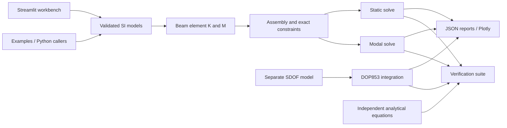

# Architecture and contribution guide

The Python package has no Streamlit dependency in its numerical modules. The UI
is a caller of the same solvers used by tests and examples. Public engineering
input models are frozen Pydantic models; validated topology is independent of
assembly. Results are typed dataclasses containing NumPy arrays in deterministic
node order. Result arrays are caller-owned and should be treated as read-only.



| Location | Responsibility |
| --- | --- |
| `src/vibra/core/models.py` | material, section, nodes, elements, DOFs, supports, loads, analysis options |
| `src/vibra/core/mesh.py` | validated straight geometry, deterministic cantilever mesh |
| `src/vibra/core/element.py` | local stiffness/mass and orientation transformation |
| `src/vibra/core/assembly.py` | global dense matrices, DOF map, constraint elimination and stability |
| `src/vibra/solvers/` | static and undamped modal results and residual checks |
| `src/vibra/dynamics/` | separate lumped SDOF equation and time integration |
| `src/vibra/verification/` | independent analytical solutions and convergence reports |
| `src/vibra/visualization/` | Plotly engineering figures, Hermite shape interpolation |
| `src/vibra/io/` | versioned SI JSON reports, explicit verification scope |
| `frontend/app.py` | parameter forms, submitted-result state, inspection and export |
| `examples/` | executable beam and SDOF cases producing actual plots |
| `tests/` | unit, analytical, integration and invalid-input checks |

No placeholder harmonic/transient/FFT modules or API service are created. Future
features should enter the package only when they can be exercised and verified.

## Reproducibility and configuration

Python 3.12 is the reference environment (`.python-version`). `uv.lock` locks direct
and transitive production/development dependencies. Use `uv sync --frozen`; run
checks through `uv run` or the environment's executables. No credentials or external
services are required for the application. Package download access is needed for a
fresh installation. Matplotlib is a development-only dependency for portfolio SVGs;
Plotly serves interactive runtime figures.

`AnalysisConfig` contains requested mode count and dimensionless stability tolerance.
`FrameModel.model_dump(mode="json")` can serialize a complete input model, and
`FrameModel.model_validate(...)` can reconstruct it. Reports carry input definitions,
SI conventions, schema/package versions and numerical results. A report records the
last submitted UI model even if form inputs have subsequently been edited.

Solvers emit informative Python logger messages without configuring the host
application's handlers. The Streamlit entry point configures INFO logging. Examples
are deterministic; no random excitation or hidden external input is used.

## Development checks

```bash
uv sync --frozen
uv run ruff check .
uv run ruff format --check .
uv run mypy
uv run pytest --junitxml=artifacts/pytest.xml
uv run vibra-verify
uv run python examples/steel_cantilever.py
uv run python examples/sdof_resonance.py
uv run python scripts/generate_portfolio.py
uv build
```

CI executes these checks (except portfolio regeneration, whose generated artifacts
are versioned). There are no paid engineering tools, Docker or MATLAB prerequisites.
Keep tests based on independent mechanics equations or invariants; do not replace
benchmarks with snapshots of the same implementation.
