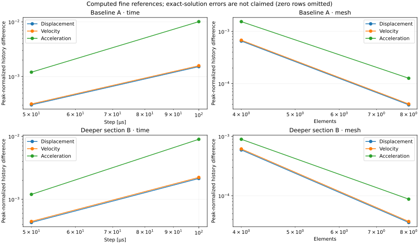

# Automotive NVH investigation — equivalent EV motor-interface support rail

VIBRA 0.5.0 combines the existing verified solvers into a reproducible engineering
investigation. The structure is a **bare equivalent cantilever rail under prescribed
interface forces**, chosen because a slender beam can be represented credibly by
the current Euler–Bernoulli formulation. It is not a solid/shell mounting bracket,
an installed motor model, or a validated production automotive component.

## Engineering objective and model boundary

Compare a baseline support rail with a deeper rail under the same assumed static,
periodic and short-duration interface forces. Identify compliance, modal shifts,
frequency-specific amplification, transient decay and the associated mass tradeoff.

The idealized load path is free-tip/interface force → rail shear/bending → a perfectly
fixed root representing a rigid fixture or attachment. Root translational and
rotational flexibility, bolt/contact behavior, chassis motion and out-of-plane
response are omitted. The current model uses only supported 2D frame elements,
with UX, UY and RZ per node. Section width is out of plane; depth is in-plane bending.

**Only rail structural mass is modeled.** A force applied at a motor interface does
not add motor inertia to M. Consequently these natural frequencies describe the
bare support idealization, not a motor-plus-bracket assembly. A realistic installed
system needs independently verified motor mass/inertia and mount compliance before
component-level interpretations are justified. The static load is also a prescribed
force; it is not a gravity-coupled motor-mass model.

## Inputs and physical meaning

All quantities are SI internally. Values are illustrative engineering assumptions,
not measured motor forces, measured damping or a specific production material grade.

| Input | Baseline A | Modified B | Interpretation |
| --- | ---: | ---: | --- |
| Length L | 0.45 m | 0.45 m | Root-to-interface lever arm |
| Width b | 0.025 m | 0.025 m | Out-of-plane rectangular width |
| Bending depth h | 0.012 m | 0.015 m | Controlled design change, +25% |
| Young modulus E | 210 GPa | 210 GPa | Illustrative steel-like elastic stiffness |
| Density rho | 7850 kg/m³ | 7850 kg/m³ | Bare structural material mass |
| Area A | 0.0003 m² | 0.000375 m² | b h |
| Second moment I | 3.6×10⁻⁹ m⁴ | 7.03125×10⁻⁹ m⁴ | b h³/12 |
| Boundary condition | fixed root | fixed root | UX=UY=RZ=0 at x=0 |
| Mesh | 8 uniform elements | 8 uniform elements | Same discretization for the comparison |
| Static interface load | −200 N | −200 N | Downward tip force, separate static case |
| Periodic force | 2 N peak | 2 N peak | Prescribed cosine-reference vertical perturbation |
| Operating assumption | order 2, 1800 rpm | same | f_exc = order × rpm/60 = 60 Hz |
| Harmonic sweep | 0–160 Hz, 401 base samples | same | 0.4 Hz spacing; exact operating point included |
| Rayleigh alpha | 4 s⁻¹ | 4 s⁻¹ | Mass-proportional damping coefficient |
| Rayleigh beta | 80 μs | 80 μs | Stiffness-proportional damping coefficient |
| Disturbance | −20 N half-sine, 10 ms | same | Separate idealized short-duration load |
| Transient duration / step | 0.4 s / 100 μs | same | Newmark average acceleration |
| Default monitor | free tip UY | free tip UY | Midspan responses also retained |

Slenderness L/h is 37.5 for A and 30 for B. The study accepts L/h≥10; its baseline
requires ≥12 to leave headroom for the controlled ±10% perturbations. These are
scope limits for this educational model, not universal beam-validity certificates.

The motor rotates at **30 Hz** for 1800 rpm. The assumed second-order force is
**60 Hz**. Order is dimensionless and is not rotational speed. No pole count,
electromagnetic model or measured operational force spectrum is inferred. The
force amplitude is assumed constant during the sweep; real motor forces generally
need their own operating/load dependence.

## Static investigation

The static tip force is applied in global Y. With no axial load, the computed axial
end forces are zero, shear is transmitted to the root, and the section bending
moment varies linearly. Both designs give root reactions [Fx,Fy,Mz]≈[0,200,90]
N/N m, balancing the applied force and its 0.45 m moment arm. Root reaction moment
and internal section moment use different signs: M_section(x)=−M1+V1*x.

| Quantity | A | B |
| --- | ---: | ---: |
| Maximum translation | 8.035714 mm | 4.114286 mm |
| Maximum absolute element end moment | 90 N m | 90 N m |
| Rail mass | 1.059750 kg | 1.3246875 kg |

The cantilever tip-load solution δ=FL³/(3EI) independently verifies static
compliance. Hermite interpolation represents its cubic displacement field exactly
apart from floating-point error. Maximum static displacement occurs at the tip.
Deformation, shear and moment are structural response results, **not** a yield,
buckling, fatigue-life or safety assessment; those capabilities are not supplied.

## Modal investigation and controlled parameters

The existing generalized symmetric eigensolver uses consistent mass and exact
constraint elimination. First natural frequencies are **49.512198 Hz** (A) and
**61.890247 Hz** (B). The +25% depth change gives +25% first bending frequency
because both stiffness and mass change: I increases by 95.3125%, area/mass by 25%.

Additional one-at-a-time runs vary L, b, h, E and rho by ±10%, leaving all other
inputs fixed. Results are checked against independent uniform-beam scaling:

- Bending f1 ∝ h L⁻² sqrt(E/rho).
- Tip compliance ∝ L³/(E b h³).
- Mass ∝ rho b h L.

A longer rail increases compliance and lowers bending frequency. Increasing E raises
frequency with sqrt(E); increasing rho lowers it with 1/sqrt(rho). Increasing width
reduces static displacement and adds mass, but does not change ideal pure bending
frequency because EI and rho A grow proportionally. These are continuum beam
properties, not a generic claim that adding material never changes frequencies.

Mode shapes retain the solver's mass normalization; display amplitudes are arbitrary
and explicitly scaled. Bending involves Y/RZ; axial modes involve X. Axial and
bending branches can interleave differently after a design change: compare families
and shapes rather than assuming a sorted mode index tracks the same physical mode.
There is no out-of-plane, torsional, rigid motor-body or automatic MAC mode tracking.

## Harmonic investigation

The harmonic solver applies the same 2 N peak force to each rail with C=alpha M+beta K.
Identical coefficients do not imply identical modal damping ratios because modal
frequencies change. First-mode zeta is approximately 1.89% for A and 2.07% for B.

| Quantity | A | B |
| --- | ---: | ---: |
| Sampled sweep maximum | 2.053681 mm at 49.6 Hz | 0.959481 mm at 62.0 Hz |
| Amplitude at the assumed 60 Hz order | 0.163289 mm | 0.553351 mm |
| Phase at 60 Hz relative to cosine force | −174.314° | −33.643° |

The deeper rail has a smaller sweep maximum but a **3.39× larger response at 60 Hz**:
its first resonance has moved closer to that operating force. This illustrates why
static stiffness alone cannot rank frequency-specific vibration behavior. Maxima
are sampled, not fitted poles; changing frequency spacing can change the sampled
peak amplitude/location. A boundary maximum does not establish a resonance.

Coefficient sensitivity runs scale alpha/beta together by 0.5, 1 and 2 with other
inputs fixed. Additional E-only runs use 0.9E/1.1E at fixed geometry/density, separating
stiffness effects from the A/B mass change. Station studies interchange tip/midspan
excitation and observation. Responses differ with modal participation; reciprocal
force/displacement transfer is checked when the stations are interchanged.
All sensitivity configurations and numerical outputs appear in the reports.

## Transient investigation and energy

Dynamics are **perturbations about the statically loaded linear equilibrium**.
The verified solvers intentionally ignore `FrameModel.loads` for dynamic forcing;
the study supplies separate pulse/harmonic loads. Static and dynamic displacements
and reactions can be superposed linearly. No geometric/prestress stiffness, motor
inertia or nonlinear change of equilibrium is modeled.

| Pulse-response quantity | A | B |
| --- | ---: | ---: |
| Monitored peak displacement | 1.184225 mm | 0.664105 mm |
| Peak velocity | 0.354353 m/s | 0.248439 m/s |
| Peak acceleration | 113.3203 m/s² | 91.8311 m/s² |
| Maximum absolute dynamic root transverse force | 49.5035 N | 48.6849 N |
| Final mechanical energy / pulse-end energy | 1.0154% | 0.1883% |
| Relative discrete energy-balance residual | 5.39×10⁻¹³ | 5.16×10⁻¹³ |

The full histories include velocity, acceleration, dynamic reactions, mechanical
energy, cumulative viscous dissipation and external work. Dynamic reactions use
M a+C v+K u−F at support DOFs, including consistent-mass and damping coupling.
Fixed supports perform no work. D/W use the existing algorithm-consistent Newmark
quadratures; a small energy residual is not proof of temporal accuracy.

Different decay rates follow the assumed Rayleigh law at different mode frequencies;
they do not establish experimentally different material damping. The very light
bare-rail model also explains why its acceleration cannot be interpreted as an
installed motor or vehicle occupant response.

## Numerical convergence and acceptance

Both designs run h, h/2, h/4 and 4/8/16-element comparisons. Time refinement holds
the selected mesh fixed. Mesh refinement holds the fine time step fixed. Histories
are compared at the same physical monitoring station and common timestamps,
normalized by the peak absolute fine-reference history. Full-grid peaks and energy
checks are also retained. Fine-reference zero is by definition, **not exact truth**.

| Base run difference from computed fine references | A | B |
| --- | ---: | ---: |
| Time-step displacement | 0.15161% | 0.21404% |
| Time-step velocity | 0.15754% | 0.22259% |
| Time-step acceleration | 1.00799% | 0.89685% |
| 8-vs-16 element displacement | 0.00392% | 0.00354% |
| 8-vs-16 element acceleration | 0.01267% | 0.00875% |

The study's exploratory acceptance targets are <1% monitored displacement difference,
<5% time-step acceleration difference and <1% mesh acceleration difference. They
are numerical study targets, not automotive acceptance standards. Acceleration is
more sensitive to high-frequency content than displacement. Source warnings that
not all FEM modes have 20 steps/cycle are retained. Refinement is still required
for a different response band, load shape or changed model.

Independent checks use tip-load static theory (<10⁻⁷ relative error), analytical
first bending frequencies (<10⁻³), global force/moment balance (<10⁻⁵ N/N m),
one-factor frequency scaling (<10⁻⁶), static scaling (<10⁻⁷) and transient energy
residuals (<10⁻⁸). These complement the original FEM/signal verification suites.
Default static analytical errors are below 10⁻¹² and first-frequency errors about
2.08×10⁻⁶. None of these checks constitutes experimental validation.



## FFT/PSD interpretation

Signal Diagnostics extracts original transient displacement and acceleration at the
selected station, not decimated report histories. Observe ringdown from twice the
pulse width through the end: default t=0.02–0.4 s, N=3801, fs=10000 Hz,
DFT duration=0.3801 s and delta-f≈**2.63088661 Hz**. Mean removal and a periodic
Hann taper are used. RMS refers to the processed pre-window time history.
PSD integration instead gives window-weighted mean square as documented in
[signal theory](signal-diagnostics.md).

Mean removal precedes tapering. For a decaying record, the tapered weighted mean
need not be zero, so residual DC/low-frequency PSD content is not an additional
structural mode. Do not zero that bin to make the plot look cleaner; that would
alter the documented power accounting.

Post-pulse displacement RMS is 0.372281 mm (A), 0.170206 mm (B); acceleration RMS
is 36.015998 and 25.750869 m/s². Dominant displacement/acceleration bins are
49.986846 Hz and 63.141279 Hz, respectively, near their first natural references
49.512198 Hz and 61.890247 Hz. Bin spacing, finite observation, damping and leakage
explain why these values differ. Peaks are not experimental modal identifications.

These spectra come from the **separate pulse/ringdown case**, not from continuous
60 Hz forcing. A harmonic operating-order response and a free-decay spectrum need
not peak at the same frequency. No sound-pressure or acoustic prediction is made.


## Engineering conclusion

B adds **25% rail mass**, reduces static deformation **48.8%**, and raises f1 **25%**.
It reduces the sampled sweep maximum and pulse-response/RMS quantities in this case,
yet increases the 60 Hz response **238.88%**. Neither design is universally superior.
A decision would require real operating forces, installed inertial properties,
mounting conditions, allowable deformation/strength and the intended frequency band.
This investigation supplies transparent structural response comparisons, not those
missing requirements or a production recommendation.

## Reproduce, inspect and export

```bash
uv run vibra-nvh-study
# Equivalent example entry point:
uv run python examples/automotive_nvh_study.py
uv run python scripts/generate_nvh_portfolio.py
```

The CLI writes complete `study.json`, `study.md`, geometry, mode and comparison HTML
figures under `artifacts/automotive-nvh-study/`, and exits nonzero if study checks
fail. Full JSON is about 5 MB for the default case and capped at 25 MB. Inputs,
models, static/modal results, selected complex harmonic histories, transient output,
full FFT spectra/provenance, parameter/location/damping studies and convergence
checks are included. Transient output uses the existing bounded 501-sample report
helper; full-grid diagnostics and original forcing remain intact. Replay inputs
for global fields. No report decimation is used as solver or FFT input.

The portfolio script saves the [generated Markdown report](results/nvh-study.md),
[compact JSON summary](results/nvh-summary.json) and genuine figures in docs/results.
The larger complete JSON stays in artifacts and can be regenerated or downloaded
from the workspace, keeping repository review practical.

Python API: `NVHConfig`, `SupportDesign` and `run_nvh_study` in `vibra.studies.nvh`;
`study_json`/`study_markdown` in `vibra.io.nvh_report`. The Streamlit **Automotive NVH
Study** workspace edits both designs and common forces, damping, stations and time
grid, then runs the whole investigation explicitly. Tabs inspect geometry/static,
modal/harmonic, transient, signals and numerical convergence/report outputs.

The study uses existing solvers without modifying their equations. It bounds meshes
to 4/8/16 elements, base intervals to 6250, base sweep samples to 1001 plus an exact
operating point, and discards full convergence histories after extracting common-grid
traces. No cloud services, GPU, proprietary CAE tools or added dependencies are needed.

## Limits and next steps

The present work does not claim experimental validation, ANSYS correlation,
production component accuracy, fatigue life, acoustic noise or validated vehicle
NVH performance. Recommended next: verified motor mass/inertia and mount-compliance
models, followed by measured-force/FRF comparisons and controlled mode tracking.
Those extensions need independent verification before stronger installed-system claims.
