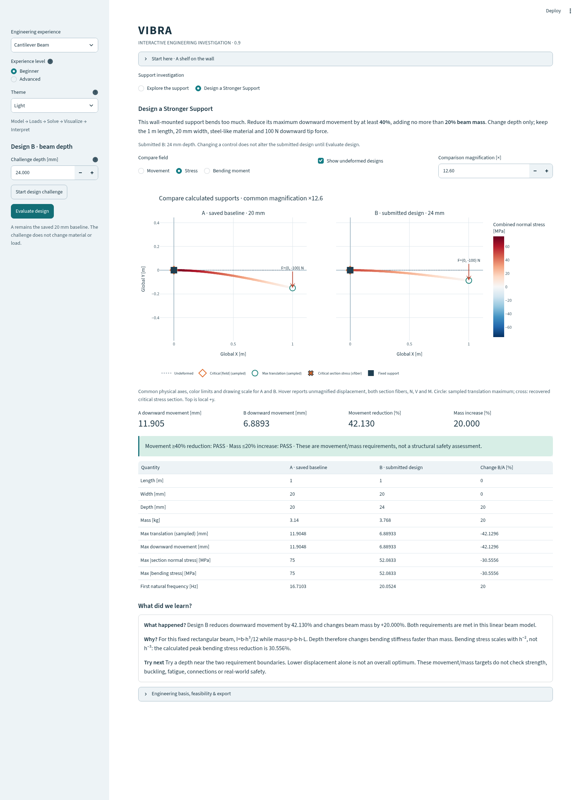

# Engineering investigation: Design a Stronger Support

VIBRA 0.9 keeps the existing verified numerical core and makes the solved model
central to a controlled design experiment. This guide is a numerical investigation,
not experimental validation or a structural safety assessment.

## Start and inspect A

Launch `uv run streamlit run frontend/app.py`. Select **Cantilever Beam**, leave
**Beginner**, then select **Design a Stronger Support** above the viewport.
Press **Start design challenge** in the left panel. This calculates and saves A;
B initially equals A. The movement requirement initially reads **NOT MET**.

A is a 1 m steel-like cantilever, 20 mm wide × 20 mm deep, with a fixed root and
100 N downward nodal tip force. E=210 GPa and density=7850 kg/m³. The existing
12-element consistent-mass Euler–Bernoulli model and static/modal solvers are used.

The task is to reduce maximum downward movement by at least 40%, while increasing
beam mass by no more than 20%. Length, width, material and force remain fixed.
Only depth changes. The targets contain no material strength or safety criterion.

## Change depth and evaluate B

Enter a **Challenge depth [mm]** between 20 and 28, then press **Evaluate design**.
Depth and evaluation are submitted together in one form. Edits remain pending
until submission. A stays saved at 20 mm; B is the last
submitted calculation. **Start design challenge** resets B to A without replacing
the stored baseline. Solver results are stored per session, not in a global mutable
cache. Theme, contour, overlay and magnification controls do not solve again.

Try 23.7, 24 and 28 mm to distinguish the requirements. Increasing depth far enough
to reduce movement does not necessarily satisfy the mass target.

Independent feasibility check, before implementing the experiment:

```
I = b h³ / 12                    mass = rho b h L
abs(delta_tip) = F L³ / (3 E I)   abs(sigma_bending_root) = F L (h/2) / I
r = h / h_A
movement reduction = 100 (1 - r^-3)
mass increase      = 100 (r - 1)
r >= (1/0.6)^(1/3) and r <= 1.2
23.712622... mm <= h <= 24.000000 mm
```

The original requirements are feasible with the existing 8–40 mm shelf limits;
the challenge deliberately exposes 20–28 mm, including unsuccessful candidates.
The displayed status is evaluated from FEM results and geometric mass, not from
these formula predictions. An inclusive boundary tolerance of 1e-7 percentage
points accommodates floating-point roundoff, not uncertainty or a design allowance.

Executed `examples/support_design_investigation.py` results:

| Quantity | A: 20 mm | B: 24 mm | B versus A |
| --- | ---: | ---: | ---: |
| Maximum downward movement [mm] | 11.904762 | 6.889330 | −42.129630% |
| Beam mass [kg] | 3.140 | 3.768 | +20.000000% |
| Maximum recovered bending stress [MPa] | 75.000000 | 52.083333 | −30.555556% |
| First natural frequency [Hz] | 16.710339 | 20.052407 | +20.000000% |

Depth increases bending stiffness cubically and mass linearly. Bending stress
changes with depth squared, so it does not fall by the same percentage as movement.
A lower displacement alone does not identify the best overall engineering design.

## Inspect the actual model and compare fairly

The two panels use a single chosen magnification, identical physical axes and a
shared contour color range. They contain the two actual calculated deformations;
neither panel is independently normalized to appear equally flexible. Choose
**Movement**, **Stress** (combined normal stress at the local top fiber), or
**Bending moment**. Toggle the undeformed dotted lines or change magnification.

Hover a station to inspect its element and local coordinate, physical UX/UY,
selected field, axial force N, shear V=dM/dx, bending moment M and both section
normal stresses. N is positive in tension; sigma=N/A−M*y/I is tension-positive;
local top means +y. Internal forces are elastic section resultants, not support
reactions or total inertial/damping force. Values at a shared node remain separate
one-sided element results; no averaging hides a force jump.

The circle marks a sampled beam translation maximum. The cross marks the
recovered absolute critical normal-stress section across both outer fibers. The
orange diamond marks the largest absolute selected field. Markers can coincide;
critical stress axis markers are not claimed 3D surface points. Magnification
changes drawing coordinates only. Translation extrema are sampled at 21 stations
per element; stress extrema include element end sections.

Read the compact comparison table and **What happened / Why / Try next**. Open
**Engineering basis, feasibility & export** for the independent bounds and a JSON
report retaining input models, computed results, comparisons and targets.




## Motor: topology, motion and transmission together

Select **Automotive Motor Mount → Run motor example**. Choose **isolated**, **rigid**
or **bare** in the viewport controls. All use the same rail and prescribed forcing;
the bare case has no added motor. The circle represents inertia through radius of
gyration, not casing dimensions. Dashed arms show massless rigid kinematics;
hourglass markers identify ideal spring/dashpot sites. Reference attachment
locations can coincide geometrically. No motor or mount stress field is invented.

Choose **Static load** (−200 N) or **Harmonic excitation** (2 N peak at the submitted
frequency). A harmonic snapshot uses Re(U exp(j theta)) from the complete complex
solution. Adjust phase and magnification without solving again. The comparison
shows first natural frequency, static interface movement, harmonic interface
amplitude/phase, motor–rail relative Y amplitude and root-force transmission.
Relative amplitude is abs(U_motor−U_rail), not abs(U_motor)−abs(U_rail).

The three summary metrics explicitly refer to the isolated configuration; the
viewport and comparison rows identify other selected topologies. Expand natural
frequencies or the secondary force-transmission sweep when needed. Softer mounts
can reduce transmission in some bands and amplify motion near coupled resonances.
Prescribed forces are assumptions; mass does not automatically become a weight load.
These are not validated vehicle properties or motor operating measurements.
Inspect the [genuine harmonic snapshot in Dark](screenshots/0.9/motor-harmonic-dark.png).

## Diagnostics: two views of one recording

Choose **Vibration Diagnostics → Analyze Example**. The left graph shows the
synthetic acceleration samples; the right shows FFT amplitude or PSD. Edit either
component frequency and press **Analyze my frequencies**. Dotted spectrum markers
identify the prescribed tones; they are not structural natural-frequency markers.
Dominant frequency, raw-record RMS and peak acceleration appear below.

**Visible time span** changes only the time-axis zoom: the spectrum and RMS still
use the full 2048 samples at 512 Hz. The stationary synthetic record lasts 4 s
(endpoint excluded), uses the original seeded noise, mean removal and Hann window,
and retains 0.25 Hz FFT bin spacing. Amplitude and RMS differ; the Hann window
reduces leakage while broadening peaks. Close components can merge. Contextual
help explains these terms. No frequency peak alone diagnoses a fault or proves a
structural mode. Advanced retains all earlier signal sources, settings and exports.

## Advanced and presentation boundaries

The sidebar **Advanced** selector retains static, modal, harmonic, transient,
installed-system, bare-rail, SDOF, FFT/PSD and CSV workflows. Mode selection and
bounded animation use real eigenvectors; amplitudes are arbitrary. Harmonic phase
cycles use complete complex states. Transient sliders use actual integration
samples and timestamps. Secondary phase/energy/convergence plots and numerical
tables are collapsible. No new physics or solver algorithm was introduced.

Plotly offers pan, zoom, legend toggles and hover. Parameter edits followed by an
explicit solve are the reliable model-editing interaction; there is no drag-to-edit
CAD or click-to-move load tool. A/B is deliberately the fixed, depth-only challenge,
not an arbitrary-model optimizer. Beam axes represent section results, not a drawn
solid section thickness. The model is linear, small-displacement, planar and slender;
it omits contact, connections, shear deformation, strength, buckling and fatigue.

Light/Dark styling covers the viewport, hover, controls, compact comparison tables
and optional animation controls. Existing native data grids and browser dialogs
may retain framework styling. The previously documented native Plotly interruption
console message remains a library limitation. No desktop frontend or custom
JavaScript component was introduced.

## Reproduction and observed performance

```bash
uv run python examples/support_design_investigation.py
uv run python scripts/measure_investigation.py
uv run pytest --junitxml=artifacts/pytest.xml
uv run ruff check .
uv run ruff format --check .
uv run mypy
```

The example produces full-precision JSON and standalone Light/Dark HTML under
`artifacts/support-investigation/`. The [executed CPU report](results/investigation-performance.json)
measured three repetitions: approximately 6.5 ms for a candidate static/modal/recovery
calculation, 86 ms for the two-design viewport, and 37 ms for its Dark presentation
copy. Its Plotly JSON was 132,391 bytes; the standalone process peaked around
140 MiB RSS. This excludes Streamlit/browser memory. Frame limits remain unchanged
(optional, maximum 60 states). These are cloud CPU observations, not Windows laptop
performance claims. Browser [capture metadata](screenshots/0.9/browser-checks.json)
records actual click-to-visible timings, colors, shared axes and error checks.
