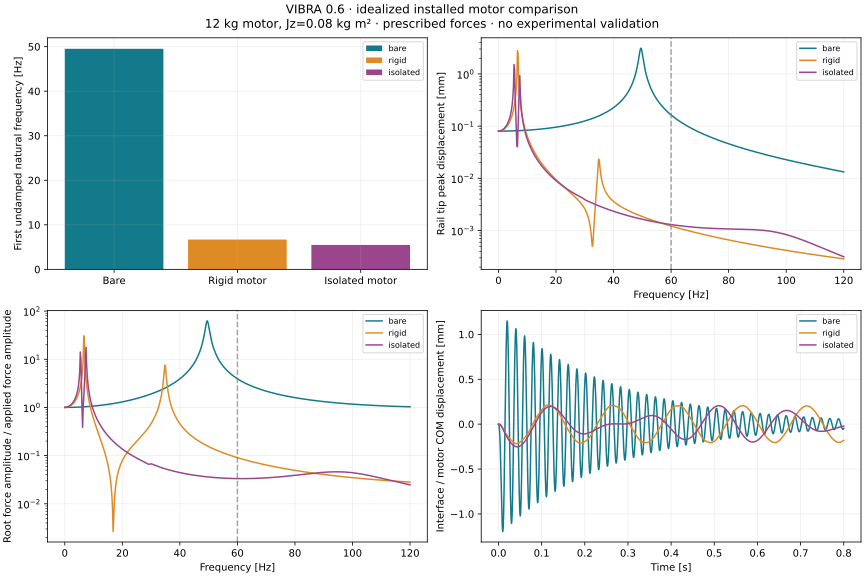
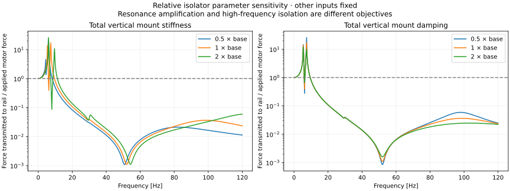

# Installed motor dynamics and compliant mounts (0.6)

VIBRA now compares a bare support rail, a rigidly attached idealized motor, and a
motor attached to the same rail through relative isolators. This is an analytical
and numerical investigation with assumed properties, not a production motor-mount
model or experimental validation. The original [0.5 bare-rail comparison](automotive-nvh-study.md)
remains separately reproducible and unchanged in its defaults.

## Physical model and load path

The rail is the original 0.45 m cantilever with a 25 × 12 mm rectangular section,
E=210 GPa, density 7850 kg/m³, and eight consistent-mass Euler–Bernoulli elements.
Its root has zero UX, UY and RZ. Its distributed structural mass is 1.05975 kg.
The three cases use the same rail; only the attachment changes:

- **A, bare:** forces act at the free rail tip; no motor inertia.
- **B, rigid motor:** one additional 12 kg body with Jz=0.08 kg m² about its COM.
  The COM is 0.08 m above the tip. Its exact infinitesimal rigid-body inertia is
  assembled at the tip reference, including UX/RZ coupling and the parallel-axis
  term. There is no invented beam with extremely large stiffness.
- **C, isolated motor:** a separate reference node at the motor COM carries the
  same 12 kg and COM inertia. Two attachment sites have X offsets ±0.06 m.
  Massless rigid arms connect each motor attachment at (±0.06,−0.08) relative to
  COM to the coincident rail-side point (±0.06,0) relative to the rail tip.
  Each site has independent X/Y springs and dashpots. Total X/Y stiffness is
  200000/80000 N/m and explicit damping is 30/60 N s/m, split equally by site.

The isolators are **between motor and rail**, not rail and ground. The rail-side
crossarm is an explicit rigid kinematic idealization, without its own flexibility
or mass. Motor → isolators → rail → fixed root is the load path. A massless rigid
arm is not an additional element or extra physical inertia. The motor mass is
added exactly once; it does not replace or duplicate the rail distributed mass.

A grounded spring is a different supported Python model: its second endpoint is
fixed ground (`node_b=None`). It provides an elastic foundation at its attachment
point; it does not create a separate moving motor or act as a motor-to-rail isolator.

The prescribed cases are −200 N static, 2 N peak cosine harmonic force, and a −20 N
half-sine pulse lasting 10 ms. Forces act vertically at the motor COM in C and the
rail tip in A/B. In B the COM-to-reference offset is purely vertical, so this
vertical force has zero additional reference moment. General COM loads must be
mapped to reference forces and moment r_x F_y−r_y F_x. No measured electromagnetic
force or gravity-coupled motor weight is implied. Harmonic and pulse cases are
separate perturbations of the linear static equilibrium; no prestress stiffness
or geometric nonlinearity is included.

## Inertia formulation

For q=[u_x,u_y,theta] and global COM offset r=[x,y], COM velocity is
[v_x−y omega, v_y+x omega]. With mass m and COM inertia J, kinetic energy gives:

```
          [ m       0          −m y          ]
M_body =  [ 0       m           m x          ]
          [−m y     m x    J + m(x²+y²)      ]
```

This matrix is symmetric positive definite for m>0,J>0, and positive semidefinite
for an ideal point mass J=0. A pure rotational contribution m=0,J>0 is also allowed
at zero offset. Negative/nonfinite values and zero total contributions are rejected.
Several contributions at the same node add; users must not supply both the same
body's reference inertia and its COM inertia as separate contributions. J is always
about the COM; the parallel-axis term is applied once by assembly.

A massless free coordinate makes the dynamic mass matrix singular. VIBRA reports
this rather than adding artificial inertia. Constrain physically inactive coordinates
in a reduced oscillator model. A standalone point model with one node and no beams
is now supported for verification; connected multi-node models can use beams and
relative mounts together.

## Mount kinematics and damping

For global direction n=[cos(phi),sin(phi)] at a point offset [x,y], the rigid
point projection is b=[n_x,n_y,−n_x*y+n_y*x]. A relative connector has extension
s=Bq=b_a q_a−b_b q_b; ground omits the second term. Assembly adds
K_mount=k BᵀB and C_mount=c BᵀB. Both are symmetric positive semidefinite for k,c≥0.
Zero k or c is allowed. Relative attachment points must coincide or lie on the
connector axis; a transverse separation otherwise spuriously strains a directional
connector under rigid rotation and is rejected. Arbitrary global angle is supported,
with exactly zero components for canonical X/Y axes.

The full equations use **M=M_beam+M_body**, **K=K_beam+K_mount**, and
**C=alpha*M+beta*K+C_mount**. Explicit mount damping is always retained, including
when the selected Rayleigh model is called `undamped` (that setting disables only
Rayleigh damping). The installed study uses alpha=0 and beta=80 μs for all three
cases. Thus its mount effective viscous coefficient is c+beta*k. Reports and force
recovery state this explicitly. These bare-case damping defaults differ from the
separately retained 0.5 study, which also used alpha=4 s⁻¹.

Mount damping is generally nonproportional. Harmonic response solves the full
complex system directly; Newmark uses the full C matrix. Modal eigenfrequencies
exclude all damping. Harmonic `modal_damping_ratios` retains its API name and reports
diagonal measures phi_iᵀ C phi_i/(2 omega_i) for mass-normalized undamped modes.
Off-diagonal modal terms are not discarded or claimed absent; these numbers do not
define decoupled modal equations and can depend on the basis in a repeated eigenspace.
Mode families with substantial mount strain energy are labeled `mount/coupled`.
They are descriptive, not automatic mode tracking.

## Force recovery and energy

Positive scalar mount force f=k*s+c*s_dot resists positive extension. Force on A
is −n*f and on B +n*f, with reference moments from the offsets. The core
`mount_forces` helper recovers the explicitly specified spring/dashpot contribution;
the harmonic/transient reports additionally include beta*k viscosity. Alpha*M remains
a separate global damping contribution.

Fixed-DOF reactions remain (M*a+C*v+K*u−F)_c. Ground mount support forces are
separate from fixed-DOF reactions: −n*f on the moving model. Static results now
expose `mount_forces_N`; dynamic reports expose mount histories. Include grounded
mount forces and their global moment arms when checking whole-model equilibrium.
Do not count them twice if a mount attaches to an already fixed coordinate.

Spring energy is included in 1/2 uᵀ K u, body kinetic energy in 1/2 vᵀ M v, and
all viscous loss in the Newmark midpoint quadrature. Fixed supports do no work.
The discrete residual E(t)−E(0)+D(t)−W(t) is a consistency check, not a guarantee
of time resolution or physical modeling accuracy.

For C, the reported transmitted force is the sum of Y forces **on the rail** at
its two mount sites, including c+beta*k. It independently satisfies
F_trans=F_motor−m*a_COM_y. For B the same identity recovers motor-to-rail force.
For A transmission into the rail equals prescribed force. The root force also
includes distributed rail inertia and damping, so the root and mount force ratios
need not agree. All ratios divide force amplitudes by the applied motor force
amplitude; they are not base-displacement transmissibility.

## Executed default comparison

| Quantity | Bare | Rigid motor | Isolated motor |
| --- | ---: | ---: | ---: |
| Rail + motor mass [kg] | 1.05975 | 13.05975 | 13.05975 |
| First undamped natural frequency [Hz] | 49.51220 | 6.69571 | 5.49166 |
| Static motor/interface Y movement [mm] | 8.03571 | 8.03571 | 10.53571 |
| Static rail-tip Y movement [mm] | 8.03571 | 8.03571 | 8.03571 |
| Motor/interface amplitude at 60 Hz [μm] | 163.723 | 1.21879 | 1.16533 |
| Rail-tip amplitude at 60 Hz [μm] | 163.723 | 1.21879 | 1.30079 |
| Root-force ratio at 60 Hz | 3.93233 | 0.0906234 | 0.0333206 |
| Motor-to-rail force ratio at 60 Hz | 1 | 0.0394241 | 0.00644003 |
| Pulse peak interface movement [mm] | 1.19525 | 0.217240 | 0.252277 |
| Pulse peak dynamic root force [N] | 49.9104 | 7.76274 | 5.06369 |

The added motor changes the dynamics strongly because its 12 kg is much larger
than the 1.06 kg rail mass. Added mass does not change the prescribed-force static
response in B. Isolators add F/Ky=2.5 mm static compliance, lower coupled frequencies,
and reduce the 60 Hz root-force ratio here. The isolated case nevertheless has a
slightly **larger rail displacement at 60 Hz** than the rigid case and a larger
pulse peak motor movement. There is no universally superior configuration.



## Parameter ranges and interpretation

One-factor studies use 0.5/1/2 times motor mass (6/12/24 kg), COM inertia
(0.04/0.08/0.16 kg m²), vertical stiffness (40/80/160 kN/m), and vertical dashpot
coefficient (30/60/120 N s/m). Geometry studies use rail depth 10.8/13.2 mm, holding
all other inputs fixed. The force remains fixed rather than scaling with motor mass.
The 0–120 Hz sweep uses 601 base frequencies and includes the exact selected operating
point. It investigates frequency dependence, not changing rotational order or speed;
60 Hz is an illustrative frequency assumption, not measured motor operation.

Lower mount stiffness generally adds low-frequency movement and can reduce
high-frequency transmitted force above the relevant coupled modes. Near resonance
it can amplify motion and forces. Extra damping can reduce peaks, fill antiresonances,
and change high-frequency transmission; the supporting rail itself has resonances.
The familiar isolated SDOF trend is not sufficient to predict every band of this
flexible multi-DOF assembly. Peak heights are sampled; a 0.2 Hz sweep can miss narrow
resonances. Use finer frequency spacing for a specific design decision.



## Numerical verification and convergence

`vibra-verify-installed` writes the independent benchmark report, including:

- f=sqrt(k/m)/(2*pi) and u=F/k for a ground-mounted mass.
- Rotational frequency sqrt(2*k*a²/J)/(2*pi) for two offset springs.
- Independent offset-body kinetic energy and the analytic roots of a coupled
  translation/rotation 2×2 determinant.
- Exact complex F/(k−m*omega²+j*c*omega), with damping from a mount only.
- Exact undamped/damped free decay and forced cosine SDOF transient response.
- Undamped energy conservation and monotone damped energy loss.
- Beam point-tip-mass continuum equation:
  1+cos(b)cosh(b)+mu*b*[cos(b)sinh(b)−sin(b)cosh(b)]=0,
  mu=m_tip/(rho*A*L), with 4/8/16-element comparisons.
- Symmetry, positive body mass and semidefinite spring stiffness checks.

The committed [verification report](results/installed-verification.json) records
individual tolerances. Typical algebraic/reference errors are below 1e-12. The
16-element tip-mass first-frequency relative error is about 8.81e-9. At dt=0.5 ms,
relative free-response displacement errors are 1.52e-4 undamped and 7.53e-5 damped;
forced-response error is 9.48e-5. Refining mount-damped dt gives second-order accuracy.
Unit tests additionally verify general-direction spring energy, rigid-motion
invariance, nonproportional modal coupling, exact constraints, zero force, invalid
inputs, limiting stiffness and motor force balance.

Installed C compares 200 μs against 100 μs time steps at eight elements, and eight
against sixteen elements at 200 μs. Common-time motor Y displacement differences
normalized by the reference peak are 0.02545% and 0.0000006681%, respectively.
These are computed finite references, not exact errors or all-mode convergence.
Default discrete relative energy residuals are below 6e-13. Acceptance is <1% for
these monitored displacement comparisons and <1e-8 for energy balance. High-mode
acceleration and dynamic reaction convergence is not established by displacement
convergence; preserve the solver's time-resolution warnings.

Finite positive stiffness values 1/100/10000 times base approach the rigid-attachment
first frequency monotonically; the last relative difference is 1.79e-5. Ground
spring zero stiffness reproduces an already stable beam exactly. Removing the only
restraint creates a free mode: current static/modal/dynamic solvers require positive
definite reduced K and reject it explicitly. They do not silently regularize free
bodies, massless coordinates or numerically extreme rigid limits.

## Reproduce and inspect

```bash
uv sync --frozen
uv run vibra-verify-installed
uv run vibra-installed-study
uv run python examples/installed_motor_study.py
uv run python scripts/generate_installed_portfolio.py
uv run streamlit run frontend/app.py
```

Choose **Automotive NVH Study → Installed motor A/B/C**, enter properties and run.
Inspect topology, undamped modes, static deformation, harmonic phase/amplitudes,
force transmission, pulse histories, energy and deformation time slider. Display
magnification is explicit; rigid arms and motor COM use the actual solved generalized
coordinates. Mode display amplitudes are arbitrary. The original **Bare rail A/B
(0.5 reference)** remains available.

Full JSON/Markdown and interactive HTML plots are written under
`artifacts/installed-motor-study/`. Full JSON is capped at 25 MB. Transient exports
retain at most 501 samples, but integration, extrema and energy diagnostics use the
full grid. Inputs and all harmonic bins are retained for replay. Compact tracked
results, reports and real PNG/SVG figures are under `docs/results/`.

Next: verify prescribed base motion and mount/chassis force paths, add controlled
mode tracking, then compare with measured mount properties and measured force/FRF
records. Nonlinear elastomer behavior, 3D motor inertia, torsion, attachment flexibility,
stress/strength, fatigue life, acoustic prediction and validated vehicle performance
remain outside scope. No ANSYS correlation or experimental validation was performed.
