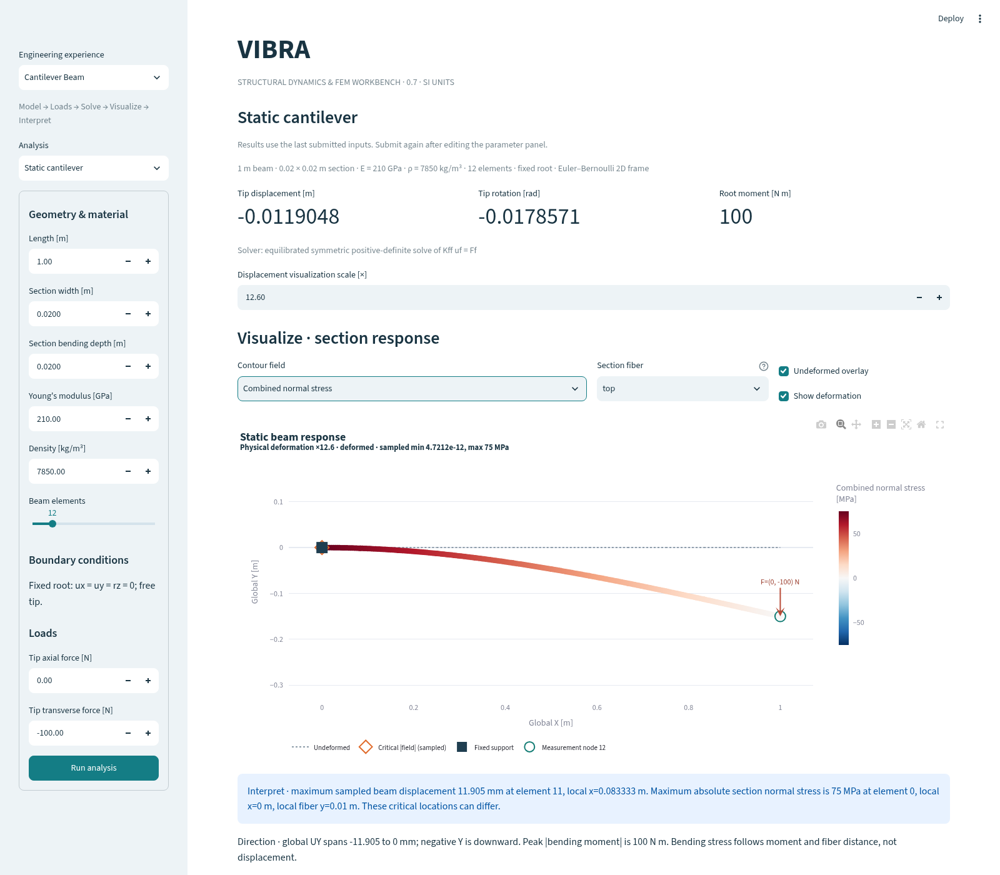
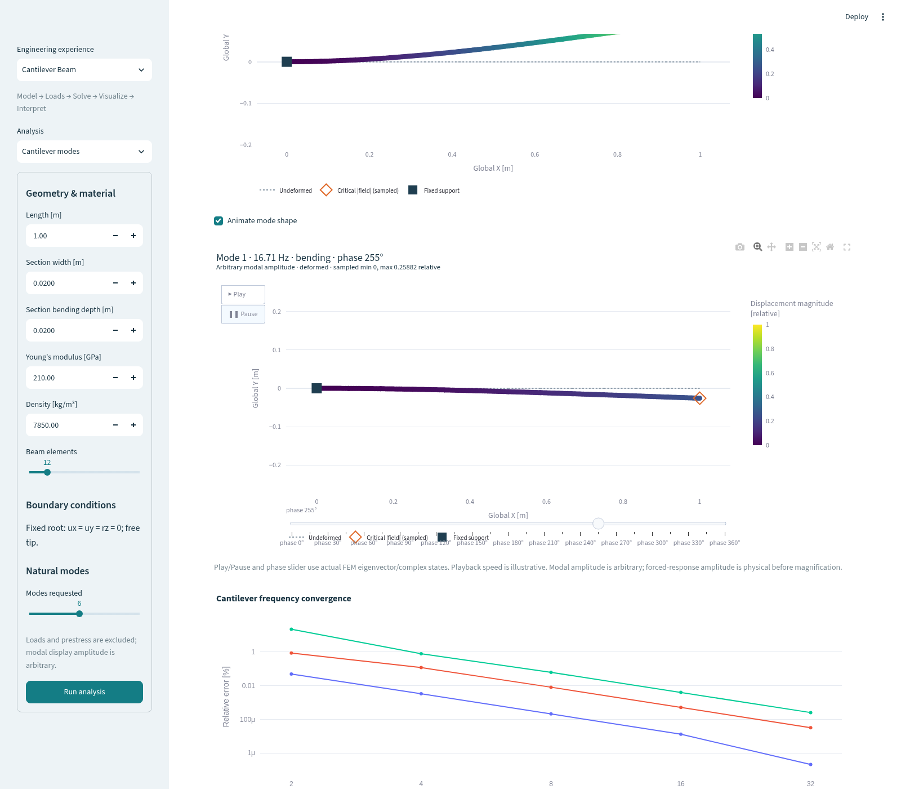
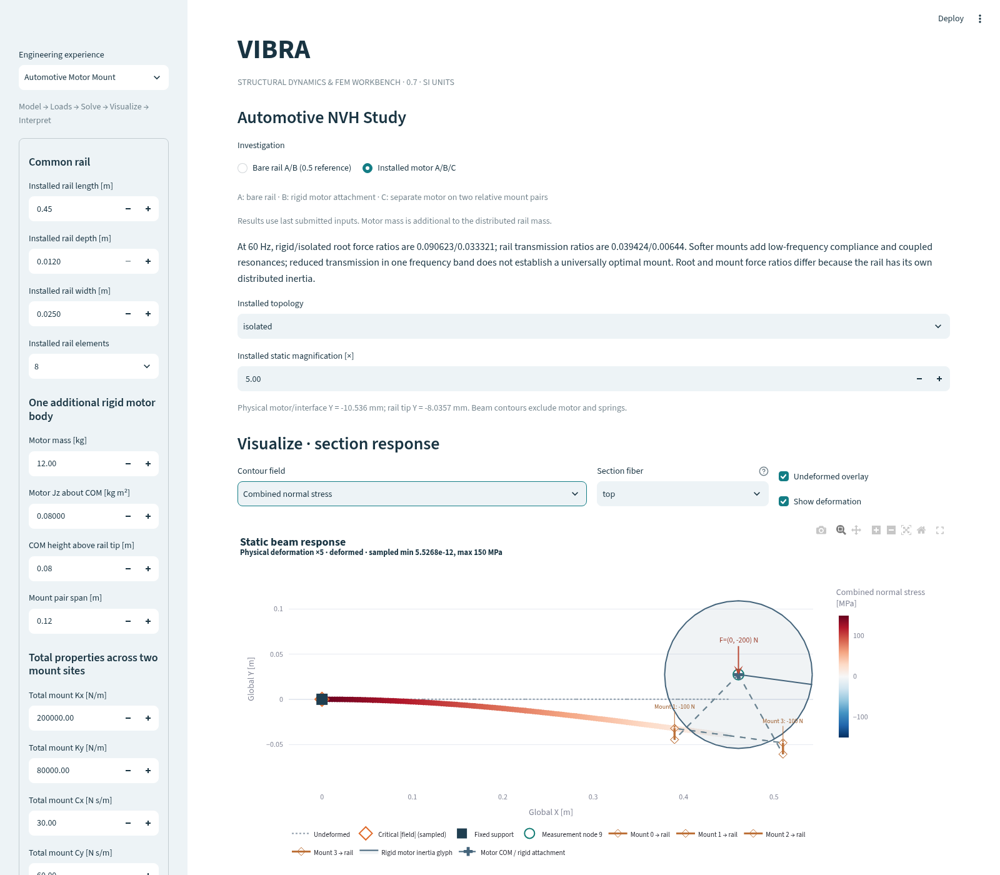

# Interactive engineering workbench and verified beam stress

For the current 0.8 Beginner entry flow, see [Getting Started](getting-started.md).
The detailed solver controls described here are available in **Advanced** mode.

VIBRA 0.7 groups the existing verified solvers into three engineering experiences.
It uses Streamlit and Plotly, with no new major physics solver or graphics engine.
The aim is to make the model, its load path and the meaning of its response visible
before asking the user to interpret numerical tables.

## A first cantilever investigation

1. Launch `uv run streamlit run frontend/app.py`. Choose **Cantilever Beam** and
   **Static cantilever**. The initial viewport shows the actual mesh, fixed root,
   downward tip force and measurement node before solving.
2. Keep the default 1 m beam, 20 × 20 mm rectangular section, E=210 GPa,
   density 7850 kg/m³, twelve elements and −100 N transverse tip force. The axial
   tip force defaults to zero. Press **Run analysis**.
3. Inspect physical tip displacement −11.9048 mm and root reaction moment +100 N m.
   The default drawing magnifies deformation by approximately 12.6; its tip appears
   around −0.15 m on the geometry axes. The physical displacement has not changed.
4. Select **Combined normal stress**, fiber **top**. The local top fiber is in
   tension, reaching approximately +75 MPa at the fixed end; the bottom fiber reaches
   −75 MPa. Select bottom to inspect the compression field. The tip displacement
   maximum and root stress maximum are different physical observations.
5. Hover over beam stations for element ID, local coordinate, unscaled global UX/UY
   and the selected field. Toggle the undeformed overlay or deformation display.
   Change magnification: the geometry changes, while stress/color/hover values remain
   unchanged. The open diamond marks the sampled largest absolute selected field.
6. Open **Axial force · shear force · bending moment**. These are local element
   diagrams, with units and sign conventions. Add +20000 N axial force and solve:
   the section axial stress is +50 MPa, giving root combined extrema +125/−25 MPa.
   This demonstrates superposition, not a strength or fatigue approval.
7. Export the section stress report or the existing solver report. Submitted results
   remain separate from unsubmitted edits; solve again to change the physics.



A force in negative global Y bends this model downward. The tip force's bending
lever arm increases toward the fixed support, so the root moment and bending stress
are largest there. The displayed interpretation uses computed displacement ranges,
section stress extrema and moments rather than assuming the tip is the stress hotspot.

## Three engineering experiences

| Experience | Available investigations |
| --- | --- |
| Cantilever Beam | Static deformation/stress, undamped modes, harmonic response, transient response |
| Automotive Motor Mount | Bare/rigid/isolated installed motor, retained 0.5 bare-rail A/B study |
| Vibration Diagnostics | Signal FFT/PSD/metrics and independent lumped SDOF reference |

The flow is **Model → Loads → Solve → Visualize → Interpret**. Existing solver controls,
multiple response DOFs, damping/excitation settings, exports and verification suites
remain available. The original UI test assertions are retained with a navigation helper
that selects their new experience. CSV signals have no invented structural geometry;
only their supplied record and actual analysis results are displayed.

## Beam field and stress formulation

Each element has local axial coordinate x from its first node to its second node,
local transverse y, and positive counterclockwise rotation. Axial motion is linear;
transverse motion is reconstructed with the same cubic Hermite interpolation as the
Euler–Bernoulli formulation. Its derivatives provide the elastic section resultants:

```
N = E A du/dx                 (positive tension)
M = E I d²v/dx²
V = E I d³v/dx³ = dM/dx
sigma_xx(x,y) = N/A − M*y/I   (positive tension)
```

These agree with elastic local element end forces: N=−N1=N2, V=V1,
M(x)=−M1+V1*x. Section moment is not the same signed quantity as the root reaction
moment. The rotated-element benchmarks verify transformation to global coordinates;
**top** always means local +y, not necessarily global upward.

Rectangular sections supply c=h/2. A generic section must explicitly supply symmetric
`extreme_fiber_distance=c`; A and I do not uniquely determine the outer fibers.
Older models without c still solve; stress recovery asks for the missing geometry.
The section extrema use both y=+c and y=−c. For the supported prismatic elements
without distributed element loads, N is constant and M linear, so stress extrema
include the end sections. Nodal force discontinuities and differing sections retain
separate one-sided values rather than averaging them together.

Displacement magnitude, by comparison, is sampled from the Hermite field, normally
at 21 stations per element. Its reported extrema and critical marker are labeled
sampled; they are not an exact polynomial optimization. Ties need not identify a
unique critical location. Hover values are the actual station values. Critical
section coordinates refer to the beam axis plus the separately stated local fiber
y; the axis marker is not a claimed 3D surface point.

The following contour choices use physical data and explicit display units:

| Field | Core units | View units | Interpretation |
| --- | --- | --- | --- |
| Displacement magnitude | m | mm | Global translation norm |
| Vertical displacement | m | mm | Signed global UY |
| Axial stress | Pa | MPa | N/A, uniform through the section |
| Bending stress | Pa | MPa | −M*y/I at selected fiber |
| Combined normal stress | Pa | MPa | N/A−M*y/I at selected fiber |
| Bending moment | N m | N m | Local elastic section moment |

Signed fields use a diverging color scale centered at zero; displacement magnitude
uses a sequential scale. Color ranges, minima, maxima and hover values are independent
of deformation magnification. Contours color the beam axis as a representation of
section results, not the interior of a 3D solid.

## Modes, harmonic cycles and transient playback

**Modes:** select mode number, frequency and family. The displayed deformation uses
the actual mass-normalized eigenvector with arbitrary user display amplitude.
Animation cycles that eigenvector with a cosine phase. Colors show relative modal
translation, not millimeters of operating motion. Modal stress contours are deliberately
excluded because an eigenvector alone does not define a physical operating amplitude.



**Harmonic:** choose a solved frequency sample and cycle phase. The snapshot and
animation use Re(U*exp(j*theta)) from the full complex FEM solution, including its
spatial phase differences. Excitation frequency, response amplitude and phase come
from the selected solved DOF; undefined phase remains marked undefined. Force arrows
follow the actual phasor reference. A phase cycle is not a transient integration.

**Transient:** the time slider selects an actual integration sample; its deformation
and the vertical cursor in the response graph share that timestamp. Optional playback
uses up to forty actual states for beams, thirty for installed motors. A synchronized
side graph moves its cursor to the same physical displacement/rotation sample, with
m/rad units. This is output sampling only; all integration histories remain intact.

Animations have Play/Pause and phase/time controls, fixed geometry/color ranges, and
an API cap of sixty frames. Generation occurs only when requested. Playback timing
is illustrative rather than physical real-time motion. The geometry itself always
comes from solved states; no synthetic oscillation replaces a numerical response.

## Installed motor topology and force paths

The default automotive investigation now opens the installed-system controls. Choose
bare, rigid motor or isolated motor after solving; the 0.5 reference remains selectable.
The viewport uses actual rail geometry, COM offsets, massless rigid arm kinematics and
mount attachment points. The motor outline is a **radius-of-gyration inertia glyph**,
sqrt(Jz/m), with an orientation spoke; it is not a claimed CAD envelope.



Physical motor/interface Y movement and rail-tip Y movement are displayed separately.
Beam-only displacement/stress extrema do not claim to describe the rigid body's
section stresses. The motor and ideal springs have no invented stress contour.
Static mount arrows/hover use computed spring forces. Dynamic snapshots include
explicit c plus beta*k viscosity recovered from the solved displacement and velocity.
Only non-negligible mount forces receive arrows; hover retains the actual scalar
values. Root and mount force plots remain available, with their different inertia
paths explained in [installed-system theory](installed-motor-dynamics.md).

## Verification and measured performance

`uv run vibra-verify-stress` checks independent pure bending, pure axial and combined
cantilever formulas at 0°, 37°, 90° and 180°. The
[executed benchmark report](results/stress-verification.json) records tolerances and
errors: largest normalized discrepancy approximately 2.14e-11 against 1e-8 acceptance.
Pure bending gives 75 MPa and pure axial loading gives 50 MPa. Other tests verify exact
cubic reconstruction/derivatives, rigid-motion zero strain, end-force signs,
contour correspondence/units, distinct critical locations, actual mount/body motion,
bounded frames, modal normalization, time/response cursors and real UI interactions.
All preceding numerical verification suites are preserved.

[Executed cloud-CPU measurements](results/viewport-performance.json) for eight elements,
21 stations per element and 25 animation frames gave roughly 1.3 ms stress recovery,
20 ms static viewport construction, and 0.61 s animation construction. The animation
JSON was about 0.71 MB, and this standalone Python measurement process peaked around
112 MiB RSS. These observations exclude browser/Streamlit memory and are not a laptop
performance guarantee. No GPU is required. Larger models and studies cost more;
optional bounded animations prevent unbounded frame/DOM growth.

```bash
uv sync --frozen
uv run vibra-verify-stress
uv run python examples/beam_stress_viewport.py
uv run python scripts/measure_viewport.py
uv run pytest
```

The example writes actual combined-stress JSON/HTML and an actual first-mode animation
under `artifacts/stress-viewport/`. The performance script records executed measurements;
it is a Linux/cloud utility, not a universal benchmark. Screenshots are unmodified
Chromium captures of the running Streamlit app, automated with an isolated Playwright
tooling environment and system Chromium. The cases and browser errors are recorded in
[screenshot provenance](screenshots/capture-metadata.json). The browser check verifies that Play advances frames and Pause freezes their
coordinates. With the current Plotly/Streamlit version, interrupting playback emits
an `undefined` browser console message; it does not prevent stopping or alter stored
solver results. The raw event is retained in screenshot provenance as a library
limitation, rather than claiming an error-free browser run. No browser tooling is added
to application dependencies. Reproduce the screens through the steps above and the
installed/mode controls.

## Scope and next step

This is linear, slender, in-plane Euler–Bernoulli beam theory with section normal
stress. It omits shear deformation, section rotary inertia, stress concentrations,
solid/contact stresses, multiaxial/von Mises strength, plasticity, fatigue and buckling.
Dynamic high-frequency stress accuracy needs its own mesh/time convergence study.
Exaggerated deformation can appear large even when the physical displacement is small;
large actual deformation still violates the linear model. Numerical verification is
not experimental validation or ANSYS correlation.

Next, gather student usability feedback and add controlled measurement/FRF ingestion
and mode tracking, while separately verifying base-motion/chassis force paths. Further
physics should follow independent verification rather than a more elaborate viewport.
