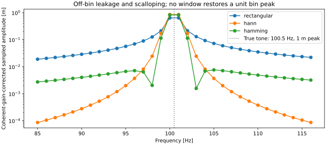

# Verified FFT and vibration signal diagnostics — VIBRA 0.4.0

The signal engine accepts real, uniformly sampled scalar SI histories independently
of any FEM model. The FEM adapter extracts original transient integration samples;
CSV import supplies externally defined signals. No solver is rewritten, no irregular
data is silently resampled, and no vibration-health categories are assigned.

## Sampling and units

`SignalSeries` requires 4–131072 finite values with matching, finite, strictly
increasing timestamps. Duplicate and missing samples are rejected. The nominal
interval is (t_last−t_first)/(N−1). Both interval deviations and deviations from
the fitted uniform grid must be no more than 10⁻⁶ of this interval; this allows
roundoff, not intentional jitter/drift. Large absolute epoch timestamps may lose
precision: provide relative seconds rather than relaxing verification.

- Sampling frequency: fs = 1/dt [Hz].
- Nyquist: fs/2 [Hz]. For odd N, the last rFFT bin lies **below** Nyquist.
- Sample span: (N−1)dt [s].
- DFT observation duration: Ndt [s].
- Frequency-bin spacing: Δf = fs/N = 1/(Ndt) [Hz].

The sample span and DFT duration are deliberately reported separately. There is
no duplicated periodic endpoint convention: all supplied samples participate once.
A transient record including its initial and final times therefore has N=T/dt+1.
Bin spacing is not a guarantee of two-tone resolving power; the window main lobe
and damping linewidth also matter. No zero-padding, resampling or alias recovery
is implemented. Physical anti-alias filtering must precede measured acquisition.

Supported units are `m`, `m/s`, `m/s^2`, `rad`, `rad/s`, `rad/s^2`. Time is seconds.
Power and PSD have squared signal units and squared signal units/Hz, respectively;
they are not mechanical watts or joules. Units are explicitly declared, not guessed
from column names, and no mm/g/unit conversions occur silently.

## Preprocessing and window definitions

`SpectrumConfig.detrend` is `none`, `mean` (default) or `linear`. Mean removal
subtracts the sample mean. Linear detrending removes a fitted least-squares line
using SciPy; it also removes its intercept. A trend-removal operation changes the
analyzed signal and can remove real low-frequency content. Raw and processed
metrics are both retained. Time metrics are computed **before tapering**.

Windows use the periodic/DFT convention (`fftbins=True`):

```
rectangular: w[n] = 1
Hann:        w[n] = 0.5 − 0.5 cos(2πn/N)
Hamming:     w[n] = 0.54 − 0.46 cos(2πn/N)
```

They are not symmetric filter-design windows based on N−1. A taper can suppress
short events near its zero/low endpoints. A retained DC mean leaks through the
taper into low-frequency bins; select mean removal for AC vibration studies.

## FFT, peak/RMS amplitude, power and PSD

For processed samples y and the unnormalized rFFT X = rFFT(yw), define q=2 for
conjugate-paired positive-frequency bins and q=1 for DC and the even-N Nyquist bin.

```
coherent gain CG = sum(w)/N
window power gain = sum(w²)/N
ENBW_bins = N sum(w²)/(sum(w))²
ENBW_Hz = fs sum(w²)/(sum(w))² = ENBW_bins Δf

peak-equivalent amplitude A_peak = q |X| / sum(w)
RMS-equivalent amplitude A_rms   = sqrt(q) |X| / sum(w)
coherent-gain bin power         = q |X|² / (sum(w))² = A_rms²
modified-periodogram PSD        = q |X|² / (fs sum(w²))
```

Thus bin power = PSD × ENBW_Hz. PSD is normalized by window energy; do **not**
apply another coherent-gain or ENBW correction to it. This is a single-record
modified periodogram, not Welch averaging or a confidence-bounded estimator.

For an isolated coherent sinusoid away from endpoint overlap, A_peak recovers its
physical peak amplitude and A_rms=A_peak/√2. DC and exact Nyquist are self-conjugate:
peak and RMS amplitudes are equal there. An even-N alternating sequence A(−1)^n
has amplitude and RMS |A|, not 2|A| or |A|/√2. Arbitrary continuous phase/amplitude
cannot be reconstructed from a sine sampled exactly at Nyquist. An odd-N last bin
is an ordinary paired bin and uses q=2.

Coherent-gain correction does not correct off-bin scalloping. Close to DC/Nyquist,
a taper can overlap positive and negative frequency contributions even for a
coherent real tone. Do not interpret every sampled amplitude as an exact physical
tone amplitude. Transient/decaying records are especially dependent on window and
observation interval.

### Parseval and integrated PSD

The discrete one-sided sum, using whole bins rather than trapezoidal endpoint
halving, satisfies:

**sum(PSD) Δf = sum(y² w²)/sum(w²)**.

For a rectangular window this is the processed mean square, equal to processed
RMS². For a taper it is a **window-weighted mean square**, generally different from
the unwindowed RMS². For an isolated coherent tone the quantities coincide under
the documented benchmark conditions; this is not a universal identity.

Summing coherent-gain bin powers gives ENBW_bins times the window-weighted mean
square. It overcounts the taper's energy spread when used as total RMS². Use PSD
integration for total/band power. Hann has CG=0.5 and ENBW=1.5 bins; Hamming has
CG=0.54 and ENBW≈1.362825789 bins; rectangular has CG=1 and ENBW=1 bin.

## Time metrics, bands and peak estimates

Original and processed records each expose:

- Mean and population standard deviation (ddof=0).
- RMS including any retained mean, peak absolute value and peak-to-peak value.
- Crest factor = peak absolute/RMS, dimensionless; undefined (`null`) for zero RMS.

Optional band RMS is sqrt(sum(PSD[k] Δf)) for bin centers inside the **inclusive**
requested band. Bounds must satisfy 0≤lower<upper≤Nyquist. Boundary bins are not
fractionally apportioned or interpolated. An empty bin selection yields zero and
an explicit note. Tapered band RMS is an estimate subject to leakage and window
weighting, not an ideal time-domain filtered RMS.

Dominant frequency is the largest resolved **non-DC PSD bin**. PSD/power ranking
avoids an artificial tie between Nyquist and its neighboring tapered peak-amplitude
bin. `peaks` contains sampled PSD local maxima ranked by PSD, plus a rising final
frequency boundary maximum. Boundary maxima are labeled because their other side
is unobserved. Constant and zero processed records have no oscillatory dominant
frequency. Candidate amplitudes below max(A_peak)×10⁻¹² or an original-record
64ε peak-amplitude roundoff floor are omitted; there is no absolute SI health cutoff.

These are approximate sampled spectral peaks, not fitted sinusoidal frequencies,
statistical significance tests, measured modal identification or health grades.
Noise also has maxima. For retained means, taper leakage may dominate low bins;
processing choices and original metrics must be reviewed.

## CSV import and resource bounds

`import_signal_csv(data, unit, time_column='time', signal_column='signal')` accepts
UTF-8 (including BOM), a header row, and 2–64 unique nonempty column names. Choose
the time and signal columns explicitly; extra columns are ignored after row-shape
validation. Selected fields must be present and numeric on every row. Blank/ragged
rows, NaN/Inf, duplicate/nonmonotonic times and nonuniform sampling are errors.
No rows are dropped or interpolated. Time uses seconds and signal units must be
one of the supported SI declarations.

Input limit: **10 MiB** and **131072 samples**. The checked-in Streamlit
configuration also limits uploads to 10 MB before import; start the app from
the repository root so this setting is loaded. Spectral reports retain original
samples, processed samples, every FFT bin and normalization/provenance metadata.
They are capped at **25 MB JSON**; oversize reports fail explicitly rather than
silently discarding bins or changing the sampling rate. Select a shorter source
record explicitly when needed. Floating-point power overflow/underflow is rejected.

## FEM integration and workbench

`signals/fem.py` is a separate adapter. `extract_transient_signal` selects any node
and UX/UY/RZ displacement, velocity or acceleration using a consecutive half-open
index slice `[start_index, stop_index)`. It reads the full integration result,
never decimated plots or transient JSON exports. It retains model/configuration,
response coordinates, source/slice sizes, units and source numerical warnings.

`natural_references` runs the modal solver separately for up to 12 modes. Spectral
peaks can be compared with the nearest **supplied** positive reference below Nyquist;
the difference and whether it lies within one FFT bin are reported. Proximity is
only a reference comparison. A peak can be forcing, transient content, leakage,
noise or an unresolved/aliased component. Not every natural mode is excited or
visible at every response DOF, and not every dominant peak is a natural mode.

In Streamlit choose **Signal Diagnostics** and either:

1. **FEM simulation:** reuse the latest Transient response result, or explicitly
   generate the real cantilever pulse case. Choose node, DOF, quantity and consecutive
   sample range. Source solver resolution warnings remain visible.
2. **CSV import:** upload or paste CSV, select column names and explicitly declare
   SI units. The workspace never assumes that imported data is experimentally validated.

Choose Hann/Hamming/rectangular, detrending and an optional RMS band, then Analyze
signal. The workspace shows full time histories, sampling metadata, amplitude and
PSD plots, sampled peaks, modal reference markers and original/processed metrics.
Primary spectrum selection and frequency-range controls change the view, not FFT
normalization or bin spacing. The second spectrum remains available in an expander.
Log axes omit zero bins; report arrays retain zeros. Source changes require a new
analysis, preventing stale results being labeled with a different channel.

## Python example and reports

```python
from vibra.signals.analysis import analyze_signal
from vibra.signals.fem import extract_transient_signal, natural_references
from vibra.signals.models import SpectrumConfig
from vibra.verification.signal_demo import cantilever_signal_case

model, config, transient = cantilever_signal_case()
record = extract_transient_signal(
    model, config, transient, node=16, quantity="acceleration", start_index=200
)
spectrum = analyze_signal(record, SpectrumConfig(window="hann", detrend="mean"))
references = natural_references(model)
```

`signal_report(record, spectrum, references)` extends the common JSON envelope with
complete provenance/units/sampling/configuration, raw and processed metrics, complex
FFT coefficients (real/imag arrays), peak/RMS amplitude, power/PSD, coherent gain,
ENBW, band RMS, candidate peaks, reference comparisons and verification limitations.
A result fingerprint binds reports to the exact supplied samples, units and
provenance; mismatched records are rejected. A small numerical tolerance is used
for internal Parseval consistency, independently of benchmark tolerances. No resampling or spectral-bin downsampling is hidden.

## Independent verification and tolerances

Run `uv run vibra-verify-signals` and `uv run pytest`. The benchmark CLI writes
`artifacts/signal-verification.json` and exits nonzero if any target fails.
The [committed reference report](results/signal-verification.json) includes actual
results, inputs, statistical assumptions and separate pass/fail checks.

| Benchmark | Expectation / tolerance |
| --- | --- |
| Coherent 100 Hz, 2.5-unit peak cosine, N=fs=4096 | corrected amplitude error <10⁻¹¹; RMS error <10⁻¹² |
| Periodic window CG and ENBW | error <10⁻¹³ against analytical coefficients |
| Integrated coherent PSD | error <10⁻¹¹ against A²/2 |
| Rectangular random-signal Parseval | absolute mean-square error <10⁻¹² |
| Mixed 64/200 Hz tones and DC | amplitude errors <10⁻¹² |
| Exact Nyquist alternating signal | peak=RMS=A; correct power, all window types |
| Odd-N last bin | ordinary paired-bin amplitude/RMS normalization |
| Fixed-seed Gaussian noise, σ=0.3 | RMS within 3%, integrated tapered PSD within 4%; statistical estimates |
| Half-bin tone at 100.5 Hz | rectangular sampled maximum 0.63–0.65; Hann 0.84–0.86 for a unit tone |
| Distant leakage, outside ±4 Hz | Hann fraction < rectangular fraction/100 |

Independent tests also compare PSD with SciPy periodogram and window-weighted mean
square derived from explicit cosine window equations. Invalid CSV/sampling, drift,
DC/zero/linear trends, band RMS, provenance, FEM extraction and workspace behavior
are exercised. Tolerances distinguish roundoff-limited exact cases from statistical
noise and approximate off-bin spectral estimates. They do not certify arbitrary
measurement systems or experimental modal parameters.



In the executed half-bin example, the corrected largest sampled amplitudes are
0.638187 (rectangular) and 0.848826 (Hann). Power beyond ±4 Hz is approximately
5.04% versus 0.00267%. This demonstrates the leakage/scalloping tradeoff rather
than concealing amplitude bias behind a visually smoother plot.

## Reproducible cantilever diagnostics

Run `uv run python examples/cantilever_signal_diagnostics.py`. It executes the
transient solver and exports tip displacement/acceleration reports, time traces,
amplitude spectra, PSDs and reference comparisons under
`artifacts/cantilever-signal-diagnostics/`. Regenerate portfolio figures and reports
with `uv run python scripts/generate_signal_portfolio.py`.

Illustrative steel beam: L=1 m, 20×20 mm section, E=210 GPa, ρ=7850 kg/m³,
16 elements, fixed root. A 1 N half-sine tip pulse lasts 40 ms. Rayleigh α=2 s⁻¹,
β_R=20 μs; Newmark dt=0.5 ms, simulation duration 3 s. Analyze samples from
0.1 through 3 s: N=5801, fs=2000 Hz, span=2.9 s, DFT duration=2.9005 s,
Δf≈0.3447681 Hz, Nyquist=1000 Hz. Processing is Hann plus mean removal.

Both displacement and acceleration select a dominant bin near **16.54887 Hz**;
the separate first FEM natural frequency is **16.71033 Hz**. Their difference
≈0.16146 Hz is less than one bin. This is a finite-record spectral comparison,
not a measured natural-frequency estimate. Damping and the observation window
broaden/reweight the decaying response; acceleration emphasizes high-frequency
content and can expose unresolved source modes. The illustrative 0.5 ms step resolves the first mode well but does not resolve
every high FEM mode: Newmark dispersion can shift higher-frequency features away
from their modal reference markers. Source warnings remain visible. Refine dt
before interpreting higher-mode acceleration peaks; Nyquist compliance alone
does not establish time-integration accuracy. Increase time resolution, mesh
resolution and observation duration as a study, not as an assertion of exact peaks.


[Demo metadata](results/signal-demo.json) records the actual observation and
independent reference values. No experimental validation or ANSYS correlation is
claimed. Next: automotive NVH case studies with explicit excitation/measurement
assumptions; Welch PSD and cross-spectral/FRF estimators are useful subsequent
extensions requiring their own verification.
