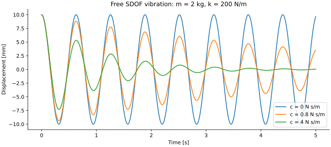

# Numerical verification

Run `uv run pytest --junitxml=artifacts/pytest.xml` and `uv run vibra-verify`.
The latter writes `artifacts/verification.json`, returns nonzero on a failed
benchmark, and records the inputs, numerical values, errors, convergence and
explicit check outcomes. A reproducible reference report is committed in
[results/verification.json](results/verification.json). Regenerate portfolio
figures and that report with `uv run python scripts/generate_portfolio.py`.

## Scope and independent checks

- Unit tests: matrix symmetry, exactly three element rigid modes, positive
  consistent mass, rigid-translation and rigid-rotation kinetic energy, exact
  constant-strain/bending energy, global assembly ordering and input rejection.
- Numerical verification: constrained matrix definiteness, zero constrained
  displacements, free equilibrium residuals, generalized eigenpair residuals,
  mass/stiffness orthogonality, and mode-family classification.
- Analytical benchmarks: cantilever displacement, slope and reactions across
  1/2/4/16/32 elements and 0°/37°/90° orientation; pure axial force and end moment;
  continuum bending/axial frequencies; bending mesh convergence; underdamped,
  undamped, critically damped, overdamped and harmonically forced SDOF solutions.
- Physical invariants: undamped free-response energy conservation and damped
  free-response energy decay. Forced-response energy need not decay.
- Integration: Streamlit's AppTest submits all seven workflows and switches a
  displayed mode while preserving the submitted engineering model.
- **Experimental validation: none.** No ANSYS comparisons have been performed.

## Tolerances

Tolerances represent floating-point conditioning and discretization separately:

| Check | Criterion | Reason |
| --- | --- | --- |
| Matrix symmetry | absolute 10⁻¹² | exact symmetric formulas in double precision |
| Element rigid motion | absolute 10⁻⁸ residual force | cancellation against large physical stiffness |
| Static analytical tip/slope | relative 2×10⁻⁷, displacement absolute 10⁻¹⁰ m | orientation and refined dense assembly roundoff |
| Reactions and total equilibrium | absolute 10⁻⁵ N or N m | cancellation at support on fine meshes |
| Static solve backward residual | ≤10⁻⁹ | normalized by ‖Kff‖∞‖uf‖∞, floor 1 |
| Positive stiffness check | λmin/λmax >10⁻¹² after equilibration | detect rigid modes and unresolved conditioning |
| Modal eigenpair residual | ≤10⁻⁶ | ‖Kφ−λMφ‖₂/(‖Kφ‖₂+‖λMφ‖₂) |
| Modal mass orthogonality | absolute 10⁻⁹ | mass-normalized modes compared with identity |
| Modal stiffness orthogonality | absolute 10⁻⁷ | divide each entry by ωiωj before comparing with identity |
| Three bending frequencies at 32 elements | relative <10⁻⁴ (0.01%) | independent continuum discretization target |
| First axial frequency at 32 elements | relative 2×10⁻⁴ | linear axial interpolation converges more slowly |
| SDOF analytical displacement | absolute 10⁻⁹ m | integration rtol=10⁻¹⁰, atol=10⁻¹² |
| Undamped energy | relative 10⁻⁸ | accumulated integration error |
| Damped energy increase | ≤10⁻¹⁰ J per sample | permits only roundoff-sized increases |

The machine-readable benchmark uses the listed 0.01% modal target, 10⁻⁷ static
tip/slope relative error and 10⁻⁵ equilibrium tolerance. Strict monotonic modal
error reduction is checked on the selected 2/4/8/16/32 meshes. It is not promised
for arbitrarily fine meshes: roundoff eventually dominates discretization error.

## Steel reference case

Illustrative inputs: L = 1 m; 20 × 20 mm square; E = 210 GPa; ρ = 7850 kg/m³;
fixed root; −100 N local transverse tip load. I = 1.3333333×10⁻⁸ m⁴.

Analytical δ = −0.0119047619 m, θ = −0.01785714286 rad;
reactions +100 N transverse and +100 N m. The first three continuum bending
frequencies are 16.71033189, 104.72186237 and 293.22424698 Hz.

| Elements | Bending f₁ [Hz] | f₂ [Hz] | f₃ [Hz] | f₃ error [%] |
| ---: | ---: | ---: | ---: | ---: |
| 2 | 16.718410 | 105.610524 | 357.194069 | 21.8160 |
| 4 | 16.710878 | 104.843885 | 295.494476 | 0.77423 |
| 8 | 16.710367 | 104.730236 | 293.402598 | 0.060824 |
| 16 | 16.710334 | 104.722397 | 293.235904 | 0.0039754 |
| 32 | 16.710332 | 104.721896 | 293.224984 | 0.0002512 |

The cantilever's cubic static displacement under a tip force is representable
exactly by Hermite interpolation even on one element (apart from floating-point
error). Mesh refinement therefore matters mainly for the dynamic shapes and
frequencies in this case. Higher modes require finer meshes. A matching tip
deflection alone does not establish accurate modal behavior.

## Harmonic verification

Version 0.2 adds independent SDOF receptance/phase, continuous beam compliance,
DC/static limits, damping sensitivity, sampled resonance and mesh-convergence
checks. Run `uv run vibra-verify-harmonic`; it writes
`artifacts/harmonic-verification.json` and exits nonzero if any criterion fails.
The [harmonic theory and verification](harmonic-response.md) documents all new
criteria. Existing tests and benchmark commands remain required. No experimental
validation or ANSYS correlation has been added.

## Transient verification

Run `uv run vibra-verify-transient` for independent continuous-time SDOF free/forced
solutions, static/zero-state limits, energy conservation/dissipation, second-order
time convergence and a continuous cantilever pulse benchmark. Original static,
modal, harmonic and SDOF checks remain required. The [transient theory](transient-response.md)
details tolerances and separates algebraic energy balance from time/space accuracy.
Tests additionally cover force events, sampled-input interpolation against independent
DOP853 integration, constraints, support inertial coupling, invalid inputs, bounded
reports and Streamlit interactions. These are numerical checks, not experiments.

## Signal verification

Run `uv run vibra-verify-signals` for coherent peak/RMS normalization, analytical
window gains/ENBW, PSD integration, Parseval, mixed/DC/Nyquist signals, half-bin
leakage/scalloping and fixed-seed noisy diagnostics. Original FEM suites remain
required. [Signal theory](signal-diagnostics.md) gives tolerances and distinguishes
window-weighted power from raw RMS². Tests additionally cover odd-N endpoints,
detrending, bands, CSV/sampling rejection, cumulative clock drift, FEM provenance
and both workspace source paths. These are numerical checks, not experimental
validation or measured modal identification.

## Automotive study verification

The original solver suites remain required. `uv run vibra-nvh-study` executes the
full default study and returns nonzero on failed study checks. It verifies global
force/moment balance, analytical cantilever compliance/f1, controlled one-factor
scaling, energy accounting and computed mesh/time differences. Tests additionally
cover reproducibility, mass consistency, solver orchestration, force/observation
reciprocity, report integrity, invalid inputs and the workbench.

[Study methodology and tolerances](automotive-nvh-study.md) distinguish numerical
acceptance targets from automotive performance criteria. Fine-reference zero is
not exact truth; the study does not validate motor inertia, mounts, component
strength/fatigue, acoustic noise, experimental modal parameters or vehicle NVH.
